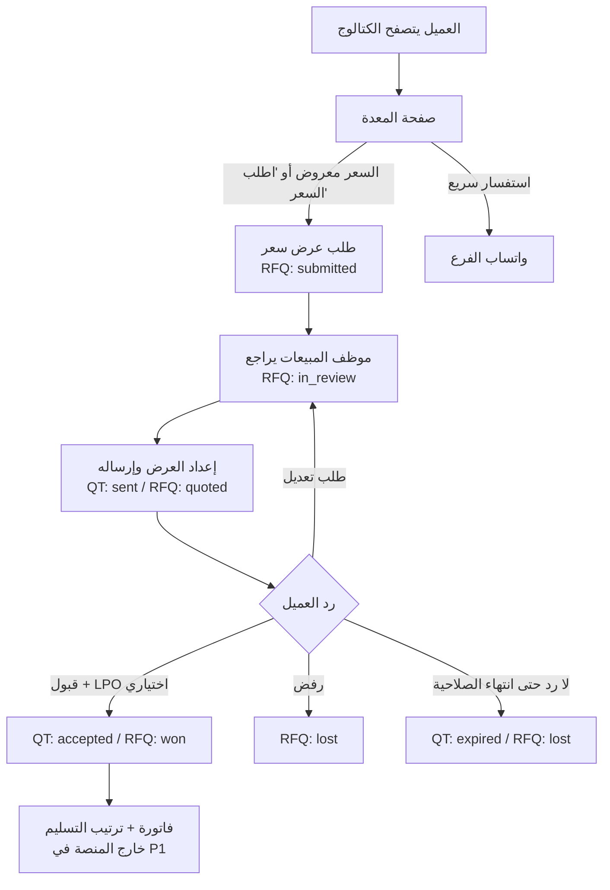
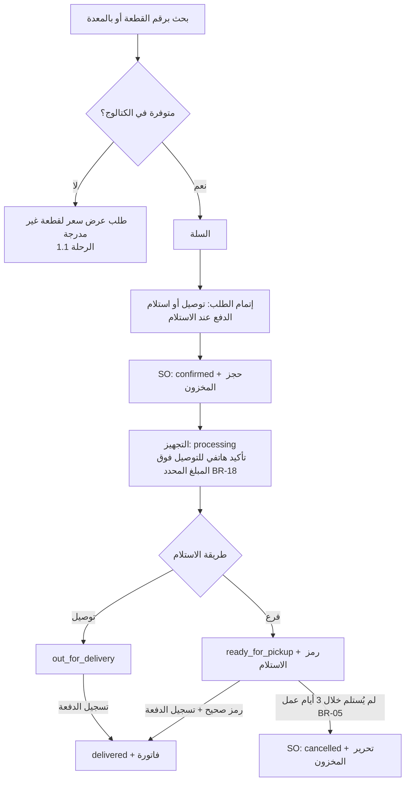
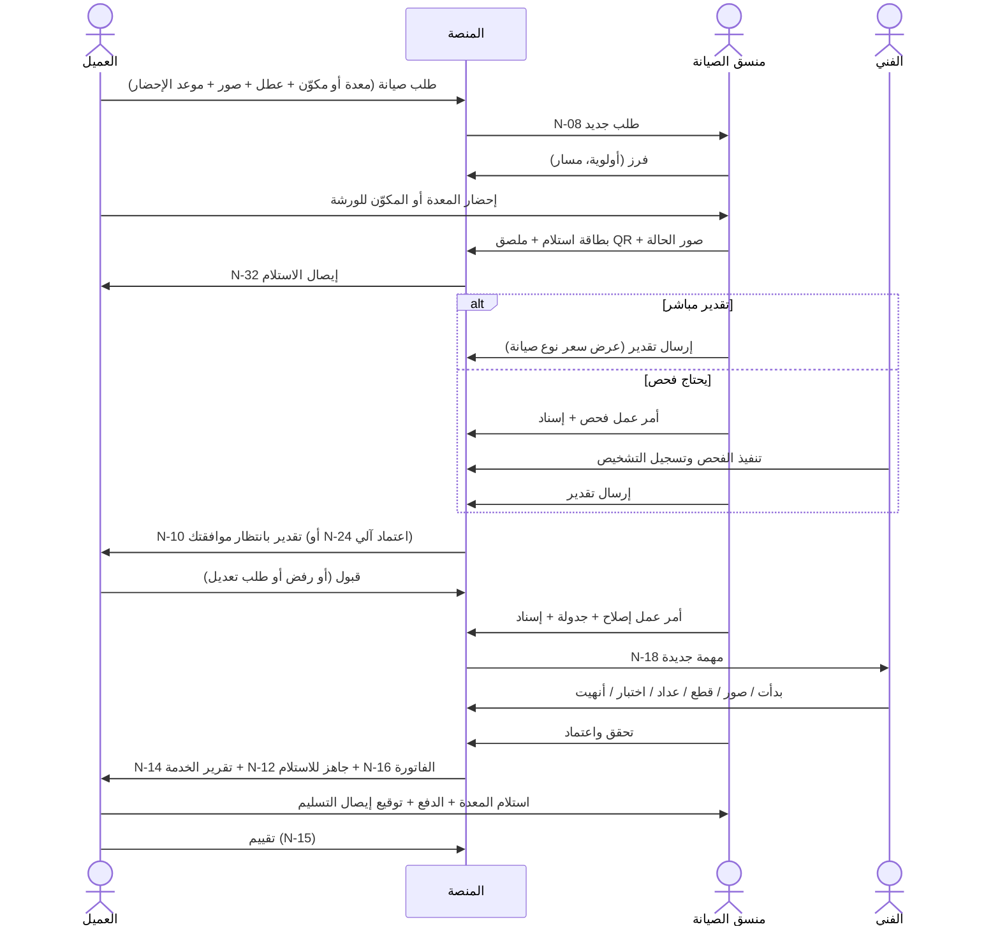
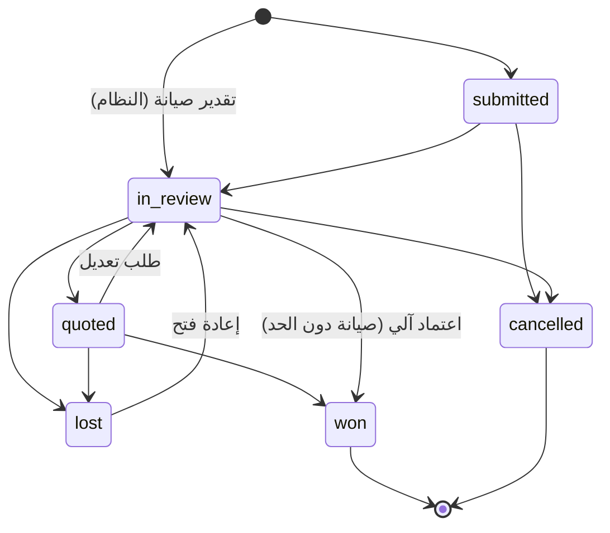
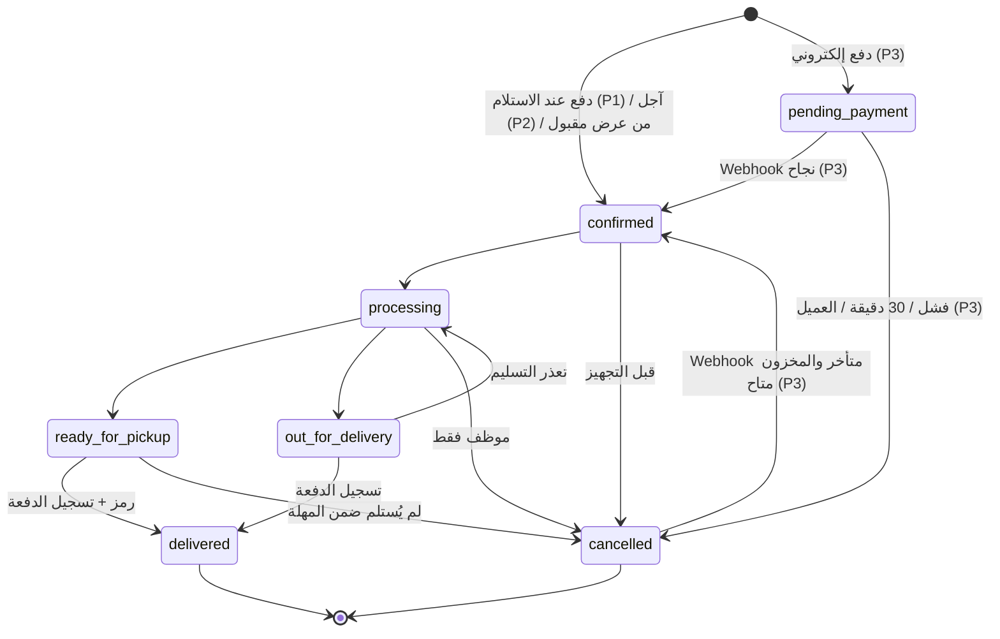
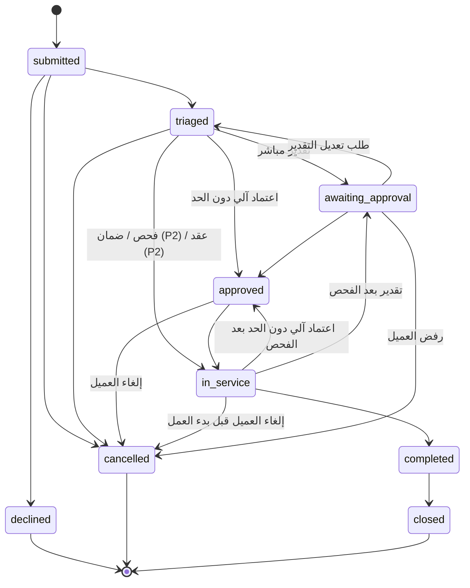
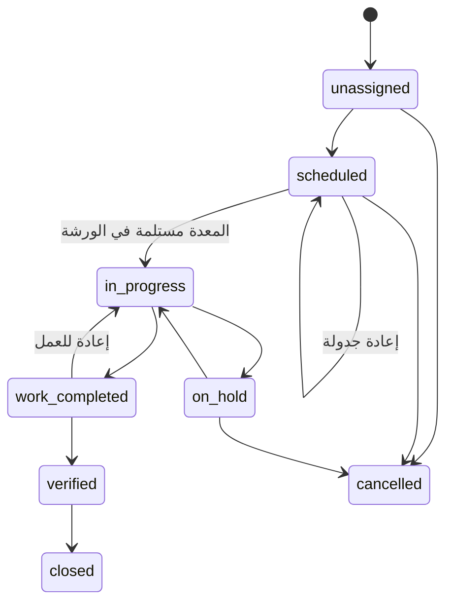

# 🔄 رحلات المستخدمين وآلات الحالات
## منصة ضواحي البادية للمعدات الثقيلة

**الإصدار:** 1.0 (مسودة)
**التاريخ:** 2026-11-15
**المرجعية:** تفصيل لـ [01_srs.md](01_srs.md). قواعد العمل (BR) والإشعارات (N) معرّفة هناك ويُشار إليها هنا بمعرّفاتها فقط.

> **كيف تُقرأ جداول الانتقال:** كل انتقال غير مذكور في الجدول **ممنوع**، والـ API يرفضه بالخطأ `INVALID_TRANSITION`. المخططات (Mermaid) للتوضيح فقط، والجدول هو المرجع عند الاختلاف.

---

## 📌 جدول المحتويات

1. [الرحلات الرئيسية](#1-الرحلات-الرئيسية)
2. [SM-1 طلب عرض السعر (RFQ)](#sm-1-طلب-عرض-السعر-rfq)
3. [SM-2 عرض السعر (Quotation)](#sm-2-عرض-السعر-quotation)
4. [SM-3 طلب القطع والإرجاع](#sm-3-طلب-القطع-والإرجاع)
5. [SM-4 طلب الصيانة](#sm-4-طلب-الصيانة)
6. [SM-5 أمر العمل](#sm-5-أمر-العمل)
7. [SM-6 الفاتورة والدفعة](#sm-6-الفاتورة-والدفعة)
8. [SM-7 الحسابات والشركات](#sm-7-الحسابات-والشركات)
9. [المهام المجدولة والمهل الزمنية](#9-المهام-المجدولة-والمهل-الزمنية)
10. [الحالات الاستثنائية](#10-الحالات-الاستثنائية)

---

## 1. الرحلات الرئيسية

### 1.1 شراء معدة (عبر عرض سعر)

### 1.2 طلب قطع غيار (الدفع عند الاستلام أو التسليم - P1)

> **في P3** يُضاف خيار الدفع الإلكتروني: إتمام الطلب ← صفحة الدفع المستضافة (`pending_payment`) ← تأكيد من Webhook (`confirmed` + فاتورة) أو إلغاء بعد 30 دقيقة. الانتقالات المعلّمة (P3) في SM-3a.

### 1.3 صيانة في الورشة (الرحلة الكاملة)

### 1.4 يوم الفني في الورشة

1. يفتح التطبيق فيرى مهام اليوم مرتبة بالموعد والأولوية (FR-TEC-01)، أو يمسح ملصق QR على المعدة لفتح مهمتها.
2. لكل مهمة: بدأت ← عمل (إيقاف واستئناف عند الحاجة) ← قطع مستخدمة من المخزن ← صور "بعد" ← عداد الساعات (للمعدة) ← الاختبار ← أنهيت.
3. عند الحاجة لقطع أو عمل إضافي: إيقاف مؤقت بسبب "بانتظار قطع/موافقة"، أو طلب عمل إضافي، فيصل للمنسق N-13.
4. إن انقطعت شبكة الورشة يُحفظ كل إدخال محلياً ويُرسل تلقائياً عند عودتها (FR-TEC-07، T-11).

---

## SM-1 طلب عرض السعر (RFQ)

**الحالات:** `submitted` ← `in_review` ← `quoted` ← (`won` | `lost`)، و `cancelled`.

| # | من | إلى | المنفّذ | الشرط | الأثر |
|---|----|-----|---------|-------|-------|
| 1.1 | (جديد) | submitted | العميل، أو موظف نيابة عنه (المصدر phone أو whatsapp أو walk_in) | بند واحد على الأقل أو وصف، ومرتبط بحساب عميل | رقم `RFQ-`، N-01 |
| 1.1b | (جديد) | in_review | النظام | طلب عرض سعر نوع "صيانة" (أساسي أو إضافي) يُنشأ عند بدء المنسق إعداد التقدير لطلب صيانة، ومسند له | رقم `RFQ-`، دون N-01 |
| 1.2 | submitted | in_review | مبيعات / منسق | إسناد الطلب لموظف | – |
| 1.3 | submitted, in_review | cancelled | العميل | طلب نوعه معدة أو قطع، ولم يُرسل أي عرض بعد. طلب الصيانة يُلغى من SM-4 انتقال 4.4 | سبب اختياري |
| 1.4 | in_review | lost | مبيعات | سبب إلزامي (غير متوفر، خارج النطاق...) | N-25 |
| 1.5 | in_review | quoted | النظام | عند إرسال عرض (SM-2 انتقال 2.2) | – |
| 1.6 | quoted | in_review | النظام | العميل طلب تعديلاً (SM-2 انتقال 2.5) | – |
| 1.7 | quoted | won | النظام | العميل قبل عرضاً صالحاً (SM-2 انتقال 2.3) | FR-RFQ-05 |
| 1.8 | quoted | lost | النظام | العميل رفض (2.4) أو انتهت صلاحية آخر نسخة (2.6) | – |
| 1.10 | in_review | won | النظام | تقدير صيانة اعتُمد آلياً دون حد الموافقة (SM-2 انتقال 2.9، BR-06) | – |
| 1.9 | lost | in_review | مبيعات، أو العميل | خلال 90 يوماً. العميل فقط لطلب نوعه معدة أو قطع، وسبب خسارته انتهاء الصلاحية (`lost_reason = 'expired'`)، بزر "اطلب تجديد العرض". تقدير الصيانة المنتهي لا يُجدد (طلب الصيانة أُلغي في 4.9، والإضافي رُفض في 4a.5) | الموظف: سبب إلزامي. العميل: إشعار الموظف المسند (N-03). تدقيق |

> طلب عرض السعر من نوع "صيانة" لا يُنشئه العميل مباشرة، بل يُنشأ تلقائياً مع التقدير في SM-4 (انتقال 1.1b).

---

## SM-2 عرض السعر (Quotation)

**الحالات:** `draft`، `sent`، `accepted`، `rejected`، `revision_requested`، `expired`، `superseded`.
كل تعديل بعد الإرسال يُنشئ **نسخة جديدة** (version + 1)، والنسخ القديمة تصبح `superseded` وتبقى للاطلاع. لا يُسمح إلا بنسخة واحدة فعالة (`sent`) لكل طلب.

| # | من | إلى | المنفّذ | الشرط | الأثر |
|---|----|-----|---------|-------|-------|
| 2.1 | (جديد) | draft | مبيعات / منسق | مرتبط بـ RFQ واحد | – |
| 2.2 | draft | sent | مبيعات / منسق | بند واحد على الأقل، وتاريخ الصلاحية ≥ اليوم، والخصم ضمن الحد أو معتمد (FR-RFQ-06 في P2)، ولعرض معدة معروضة: ليست محجوزة أو مباعة لعميل آخر (BR-19)، وللصيانة دون حد الموافقة: يُطبق 2.9 بدلاً من هذا الانتقال | توليد PDF، رقم `QT-`، N-02، RFQ ← quoted |
| 2.3 | sent | accepted | العميل (عضو بصلاحية اعتماد أو مالك) | الآن ≤ valid_until، وللآجل: LPO مرفق وشركة موثقة (BR-08)، ولعرض معدة معروضة: ليست محجوزة أو مباعة لغيره (BR-19) | N-03، RFQ ← won، FR-RFQ-05، حجز المعدة (BR-19) |
| 2.4 | sent | rejected | العميل | سبب اختياري من قائمة | N-03، RFQ ← lost |
| 2.5 | sent | revision_requested | العميل | ملاحظة إلزامية | N-03، RFQ ← in_review |
| 2.6 | sent | expired | النظام (مهمة J-02) | الآن > valid_until | RFQ ← lost (سبب: انتهاء) |
| 2.7 | sent, revision_requested | superseded | النظام | عند إرسال نسخة أحدث | – |
| 2.8 | draft | (حذف) | المنشئ | لم يُرسل أبداً | – |
| 2.9 | draft | accepted | النظام (عند ضغط المنسق "إرسال") | عرض صيانة لشركة، وإجماليه ≤ حد الموافقة المسبقة للشركة (BR-06) | رقم `QT-` و PDF، N-24، RFQ ← won، ثم كالقبول: SM-4 انتقال 4.14 للتقدير الأساسي أو 4a.6 للإضافي |

**ممنوع:** تعديل عرض بحالة `sent` أو بعدها، وقبول عرض `expired` أو `superseded`.

---

## SM-3 طلب القطع والإرجاع

### SM-3a طلب القطع (Sales Order)

| # | من | إلى | المنفّذ | الشرط | الأثر |
|---|----|-----|---------|-------|-------|
| 3.0 | (جديد) | confirmed | العميل | الدفع عند الاستلام أو التسليم (P1)، والسلة صالحة (السعر والتوفر محدثان)، وطلباته المفتوحة غير المدفوعة < الحد (BR-05) | حجز المخزون، رقم `SO-`، N-05، N-23. **لا فاتورة بعد** |
| 3.1 | (جديد) | pending_payment | العميل | (P3) دفع إلكتروني، والسلة صالحة | حجز المخزون، رقم `SO-`، إنشاء دفعة `initiated` |
| 3.2 | (جديد) | confirmed | العميل | دفع آجل: شركة موثقة وضمن حد الائتمان (BR-08، P2) | حجز، فاتورة، N-05، N-23 |
| 3.3 | pending_payment | confirmed | النظام | (P3) Webhook موقّع، والمبلغ والعملة مطابقان | الدفعة ← succeeded، فاتورة، N-05، N-23 |
| 3.4 | pending_payment | cancelled | النظام / العميل | (P3) فشل الدفع، أو مرور 30 دقيقة (BR-05)، أو إلغاء العميل | تحرير الحجز، N-07 |
| 3.5 | confirmed | processing | موظف القطع | للتوصيل فوق المبلغ المحدد: التأكيد الهاتفي مسجل (BR-18) | – |
| 3.6 | confirmed | cancelled | العميل / موظف | قبل التجهيز (BR-13) | تحرير الحجز. وإن وُجدت دفعة: استرداد كامل (SM-6) وإشعار دائن |
| 3.7 | processing | cancelled | موظف القطع | سبب إلزامي | تحرير الحجز، تدقيق. وإن وُجدت دفعة: استرداد وإشعار دائن |
| 3.8 | processing | ready_for_pickup | موظف القطع | fulfillment = pickup | توليد رمز استلام من 6 أرقام، بدء مهلة الاستلام (BR-05)، N-06 |
| 3.9 | processing | out_for_delivery | موظف القطع | fulfillment = delivery | N-06 |
| 3.10 | out_for_delivery | processing | موظف القطع | تعذر التسليم أو رفض العميل الدفع (سبب) | N-26 |
| 3.11 | ready_for_pickup | delivered | موظف القطع في الفرع | إدخال رمز الاستلام الصحيح، **و** تسجيل الدفعة بالإجمالي (BR-18) أو أن الطلب مدفوع أو آجل | خصم المخزون نهائياً، إصدار الفاتورة (إن لم تصدر)، N-06 |
| 3.12 | out_for_delivery | delivered | موظف القطع المكلّف بالتوصيل | صورة إثبات أو توقيع، **و** تسجيل الدفعة (BR-18) أو أن الطلب مدفوع أو آجل | خصم المخزون، إصدار الفاتورة (إن لم تصدر)، N-06 |
| 3.13 | ready_for_pickup | cancelled | النظام (J-01) | لم يُستلم خلال المهلة (BR-05)، وتذكير قبلها بيوم (N-07) | تحرير الحجز، N-07، زيادة عداد عدم الاستلام للعميل (§10) |
| 3.14 | (جديد) | confirmed | النظام / موظف القطع | عرض قطع مقبول (SM-2 انتقال 2.3، FR-RFQ-05). البنود والأسعار من العرض لا من الكتالوج (BR-17)، والبنود غير المدرجة تُضاف للكتالوج أولاً. الدفع عند الاستلام أو التسليم، أو آجل (BR-08، P2). لا يُطبق حد الطلبات المفتوحة | حجز المخزون، رقم `SO-` مع `rfq_id`، N-05، N-23 |
| 3.15 | cancelled | confirmed | النظام | (P3) أُلغي الطلب لانتهاء مهلة الدفع (3.4)، ثم وصل Webhook نجاح، والمخزون ما زال متاحاً | إعادة الحجز، الدفعة ← succeeded، فاتورة، N-05، N-23 |

> **لماذا لا توجد حالة `refunded` للطلب؟** الاسترداد حالة للدفعة (SM-6) وليس للطلب، فالطلب الملغى المدفوع يُعرف استرداده من دفعاته.
> **لماذا لا توجد حالة "بانتظار الدفع عند الاستلام"؟** الدفع عند الاستلام شرط على انتقال التسليم (3.11 و 3.12) وليس حالة، فالطلب يمر بنفس حالات التجهيز في كل طرق الدفع.

### SM-3b طلب الإرجاع (Return Request)

| # | من | إلى | المنفّذ | الشرط | الأثر |
|---|----|-----|---------|-------|-------|
| 3b.1 | (جديد) | requested | العميل | الطلب delivered، وضمن المدة، والصنف قابل للإرجاع (BR-12)، مع السبب والصور | N-27 لموظفي القطع |
| 3b.2 | requested | approved | موظف القطع | – | N-27 للعميل مع تعليمات الإرجاع |
| 3b.3 | requested | rejected | موظف القطع | سبب إلزامي | N-27 للعميل |
| 3b.4 | approved | received | موظف القطع | فحص القطعة | إعادة للمخزون إن كانت صالحة |
| 3b.5 | received | refunded | المحاسب | – | استرداد جزئي (SM-6)، إشعار دائن |

---

## SM-4 طلب الصيانة

طلب الصيانة هو ما يراه العميل. التنفيذ يتم في أوامر عمل (SM-5) مرتبطة به. حالة `in_service` يُعرض للعميل تحتها تفصيل من حالة أمر العمل النشط.

| # | من | إلى | المنفّذ | الشرط | الأثر |
|---|----|-----|---------|-------|-------|
| 4.1 | (جديد) | submitted | العميل، أو موظف عند حضور العميل للورشة (مع الاستلام مباشرة، FR-SRV-08)، أو النظام (عقد صيانة دورية، P2، FR-SRV-06، `source = 'contract'`: الرسوم مشمولة بالعقد، والمهلة موعد الاستحقاق) | (معدة من الأسطول **أو** مكوّن منفصل) + وصف نصي أو صوتي + الموعد المفضل لإحضارها إلى الورشة | رقم `SR-`، N-08، بدء عداد SLA |
| 4.2 | submitted | triaged | المنسق | تحديد الأولوية والفرع والمسار | إيقاف عداد SLA |
| 4.3 | submitted | declined | المنسق | سبب إلزامي (نوع معدة أو عمل غير مدعوم، أو لا تتوفر القدرة) | N-25. وإن كانت المعدة في الورشة: تسليمها (FR-SRV-09) |
| 4.4 | submitted, triaged, awaiting_approval, approved, in_service | cancelled | العميل | لا يوجد أمر عمل حالياً بحالة in_progress أو work_completed، ولم يبدأ العمل في أي أمر إصلاح (لم يمر بحالة in_progress)، وإلا يتواصل العميل مع المنسق. رسوم الإلغاء تُعرض قبل التأكيد | إلغاء أوامر العمل المفتوحة (5.14، 5.15). مجاناً إن لم يكتمل فحص، وإلا رسوم الفحص (BR-11) بفاتورة. وإن كانت المعدة في الورشة: تسليمها للعميل (FR-SRV-09) |
| 4.5 | triaged | awaiting_approval | النظام | المنسق أرسل تقديراً (SM-2 انتقال 2.2) | N-10 |
| 4.6 | triaged | in_service | المنسق | إنشاء أمر عمل فحص (مع رسومه المعلنة)، أو (P2) أمر إصلاح لعمل ضمان أو مشمول بعقد (BR-06). التقدير دون حد الموافقة لا يمر من هنا بل بعرض يُعتمد آلياً (4.14) | SM-5 |
| 4.7 | in_service | awaiting_approval | النظام | إرسال التقدير الأساسي بعد الفحص: أمر عمل الفحص work_completed أو verified، ولا يوجد أمر إصلاح نشط | N-10 |
| 4.8 | awaiting_approval | approved | النظام | العميل قبل التقدير الأساسي (2.3) | – |
| 4.9 | awaiting_approval | cancelled | النظام | العميل رفض التقدير الأساسي (2.4)، أو انتهت صلاحيته (2.6) | فاتورة رسوم الفحص إن وجدت، وتسليم المعدة للعميل (FR-SRV-09) |
| 4.10 | awaiting_approval | triaged | النظام | العميل طلب تعديل التقدير الأساسي (2.5) | – |
| 4.11 | approved | in_service | المنسق | إنشاء أمر عمل الإصلاح | SM-5 |
| 4.12 | in_service | completed | النظام | كل أوامر العمل verified أو closed أو cancelled، وواحد منها على الأقل verified أو closed، ولا يوجد طلب عمل إضافي pending أو quoted | تقرير الخدمة PDF، N-14، و N-12 جاهز للاستلام |
| 4.13 | completed | closed | النظام | سُلّمت المعدة أو المكوّن للعميل (FR-SRV-09، BR-20)، والفواتير المرتبطة صدرت أو "بلا تكلفة" | N-15 بعد 24 ساعة |
| 4.14 | triaged, in_service | approved | النظام | التقدير الأساسي اعتُمد آلياً دون حد الموافقة (SM-2 انتقال 2.9، BR-06) | N-24، ثم 4.11 |

### العمل الإضافي أثناء التنفيذ (FR-TEC-05)
العمل الإضافي **لا يغيّر حالة طلب الصيانة** (يبقى `in_service`)، والعمل المعتمد سابقاً لا يتوقف بسببه إلا إن اختار الفني ذلك. التقدير الإضافي عرض سعر نوع "صيانة" في طلب عرض سعر مستقل مرتبط بنفس طلب الصيانة (03 §7).

| # | من | إلى | المنفّذ | الشرط | الأثر |
|---|----|-----|---------|-------|-------|
| 4a.1 | (جديد) | pending | الفني | أمر العمل in_progress، مع الوصف والصور | N-13. الفني يختار: متابعة العمل المعتمد، أو إيقاف مؤقت "بانتظار موافقة" (5.8) إن كان الإضافي يمنع المتابعة |
| 4a.2 | pending | quoted | النظام | المنسق أرسل التقدير الإضافي (2.2) | N-10 |
| 4a.3 | pending | rejected | المنسق | العمل غير لازم أو خارج النطاق، والسبب إلزامي | إشعار الفني (N-18) |
| 4a.4 | quoted | approved | النظام | العميل قبل التقدير الإضافي (2.3) | إشعار الفني (N-18)، ويُضاف للفاتورة |
| 4a.5 | quoted | rejected | النظام | العميل رفض التقدير الإضافي (2.4) أو انتهت صلاحيته (2.6) | إشعار الفني (N-18). يكتمل العمل المعتمد فقط، ولا يُلغى طلب الصيانة |
| 4a.6 | pending | approved | النظام | التقدير الإضافي اعتُمد آلياً دون حد الموافقة (SM-2 انتقال 2.9، BR-06) | N-24، إشعار الفني (N-18)، ويُضاف للفاتورة |

### تسميات الحالة للعميل
| الحالة الداخلية | ما يراه العميل (عربي) | (English) |
|-----------------|----------------------|-----------|
| submitted | تم استلام طلبك | Request received |
| triaged | قيد المراجعة | Under review |
| awaiting_approval | بانتظار موافقتك على التكلفة | Awaiting your approval |
| approved | تمت الموافقة، جارٍ الجدولة | Approved, scheduling |
| in_service + لم تُستلم المعدة بعد | بانتظار إحضار المعدة إلى الورشة | Awaiting drop-off at workshop |
| in_service + WO unassigned | جارٍ تحديد الموعد | Scheduling |
| in_service + WO scheduled | موعد العمل: {التاريخ} | Work scheduled: {date} |
| in_service + WO in_progress | جارٍ العمل | Work in progress |
| in_service + WO on_hold | متوقف مؤقتاً: {السبب} | On hold: {reason} |
| in_service + تقدير إضافي quoted | بانتظار موافقتك على عمل إضافي | Additional work awaiting your approval |
| in_service + WO work_completed | اكتمل العمل، قيد المراجعة النهائية | Work done, final review |
| completed | جاهز للاستلام من الورشة | Ready for collection |
| closed | مغلق | Closed |
| cancelled | ملغى | Cancelled |
| declined | تعذّر قبول الطلب: {السبب} | Declined: {reason} |

---

## SM-5 أمر العمل

**الأنواع:** `inspection` (فحص)، `repair` (إصلاح)، `preventive` (وقائي، P2)، `warranty` (ضمان، P2 مع FR-SRV-07). في P1 يغلق المنسق أمر العمل "بلا تكلفة" عند الحاجة (إعادة إصلاح سابق مثلاً) دون نوع ضمان.
**مكان التنفيذ:** الورشة فقط (Q-08). لا توجد حالات انطلاق أو وصول.

| # | من | إلى | المنفّذ | الشرط | الأثر |
|---|----|-----|---------|-------|-------|
| 5.1 | (جديد) | unassigned | المنسق / النظام | طلب صيانة triaged أو approved (أو عقد في P2) | رقم `WO-` |
| 5.2 | unassigned | scheduled | المنسق | فني رئيسي + نافذة زمنية، ولا تعارض في جدول الفني (أو تجاوز بتأكيد) | N-11 للعميل، N-18 للفني |
| 5.3 | scheduled | scheduled | المنسق | تغيير الموعد أو الفني، والسبب إلزامي | N-11، N-18 |
| 5.7 | scheduled | in_progress | الفني | المعدة أو المكوّن مستلَم في الورشة (BR-20)، ويوم الموعد اليوم أو فات | بدء وقت العمل |
| 5.8 | in_progress | on_hold | الفني / النظام | سبب: بانتظار قطع، بانتظار موافقة، بانتظار العميل (معلومة أو قطعة منه)، نهاية الدوام | إيقاف وقت العمل، N-13 |
| 5.9 | on_hold | in_progress | الفني | زال السبب (إن كان السبب موافقة: قُبل العمل الإضافي أو رُفض، 4a.4 أو 4a.5) | استئناف الوقت |
| 5.10 | in_progress | work_completed | الفني | شروط BR-07 كلها | إيقاف الوقت، N-28 |
| 5.11 | work_completed | in_progress | المنسق | ملاحظة إلزامية (نقص صور، تقرير غير واضح) | N-18 للفني |
| 5.12 | work_completed | verified | المنسق | مراجعة التقرير | تحقق 4.12 في SM-4 |
| 5.13 | verified | closed | النظام | إصدار الفاتورة أو "بلا تكلفة" (قرار المنسق، أو ضمان/عقد في P2) | – |
| 5.14 | unassigned, scheduled | cancelled | المنسق / النظام (إلغاء العميل 4.4) | سبب إلزامي | N-29 للفني والعميل |
| 5.15 | on_hold | cancelled | المنسق / النظام (إلغاء العميل 4.4) | سبب إلزامي | N-29، تدقيق |

**قيود إضافية:**
- الفني يغيّر حالة أوامر العمل المسندة إليه فقط.
- لا يكون للفني إلا أمر عمل واحد بحالة `in_progress` في وقت واحد.
- الانتقالات المسجلة بدون اتصال تُرسل بوقتها الفعلي (`occurred_at`) وتُطبق بالترتيب عند المزامنة (04_architecture.md §6).

---

## SM-6 الفاتورة والدفعة

### SM-6a الفاتورة

| # | من | إلى | المنفّذ | الشرط | الأثر |
|---|----|-----|---------|-------|-------|
| 6.1 | (جديد) | draft | النظام / المحاسب | مصدر واحد: طلب قطع (بما فيه الناتج عن عرض قطع، 3.14)، أو عرض معدة مقبول، أو طلب صيانة (عن أوامر عمله المعتمدة، وقد يكون لطلب الصيانة أكثر من فاتورة، مثل رسوم الفحص ثم الإصلاح) | – |
| 6.2 | draft | issued | النظام / المحاسب | – | رقم `INV-` متصل (BR-14)، PDF، N-16. **لا تعديل بعد الإصدار** |
| 6.3 | issued | partially_paid | النظام | مجموع الدفعات الناجحة > 0 و < الإجمالي | – |
| 6.4 | issued, partially_paid | paid | النظام | مجموع الدفعات الناجحة = الإجمالي | – |
| 6.5 | issued | void | المحاسب | لا دفعات ناجحة، والسبب إلزامي | إشعار دائن بالقيمة الكاملة، تدقيق |

> "متأخرة" ليست حالة: تُحسب من `due_date < اليوم` والحالة ∈ {issued, partially_paid} (BR-15).
> الاسترداد بعد الدفع يتم بإشعار دائن (Credit Note) + استرداد للدفعة، ولا تُلغى الفاتورة.

### SM-6b الدفعة

| # | من | إلى | المنفّذ | الشرط | الأثر |
|---|----|-----|---------|-------|-------|
| 6b.1 | (جديد) | initiated | النظام | (P3) إنشاء جلسة دفع لدى البوابة بمفتاح Idempotency | – |
| 6b.2 | initiated | succeeded | النظام | (P3) Webhook موقّع والمبلغ مطابق | تحديث الفاتورة أو الطلب |
| 6b.3 | initiated | failed | النظام | (P3) Webhook فشل، أو انتهاء الجلسة | N-07 |
| 6b.4 | (جديد) | succeeded | موظف القطع (عند التسليم) / المحاسب | دفعة يدوية (نقد، بطاقة عبر نقاط البيع، تحويل، شيك) مع مرجع. **الطريقة الوحيدة في P1 و P2** | تدقيق، تحديث الفاتورة، شرط التسليم في SM-3a |
| 6b.5 | succeeded | refunded / partially_refunded | المحاسب / النظام | مجموع الاستردادات ≤ المبلغ | سجل في جدول الاستردادات |

---

## SM-7 الحسابات والشركات

| الكيان | الحالات | الانتقالات |
|--------|---------|------------|
| المستخدم | `active`، `suspended`، `deleted` | active ↔ suspended (مدير، سبب إلزامي)؛ active → deleted (المستخدم أو المدير، ثم التجهيل بعد 30 يوماً BR-16) |
| توثيق الشركة (P2) | `unverified`، `pending`، `verified`، `rejected` | unverified → pending (رفع المستندات)؛ pending → verified أو rejected (موظف، السبب إلزامي للرفض)؛ rejected → pending (إعادة رفع)؛ verified → unverified (انتهاء صلاحية السجل التجاري، مهمة J-07) |
| دعوة عضو | `pending`، `accepted`، `expired`، `revoked` | تنتهي بعد 7 أيام |
| جهاز الفني | `active`، `revoked` | يُربط برمز تفعيل (FR-AUTH-03). المدير أو المنسق يلغي الجهاز (A-11)، فتُمسح البيانات المحلية عند أول اتصال |

---

## 9. المهام المجدولة والمهل الزمنية

| المعرف | المهمة | التكرار | القاعدة |
|--------|--------|---------|---------|
| J-01 | إلغاء طلبات القطع المنتهية مهلتها | كل 5 دقائق (ودقيقة في P3) | BR-05: غير المستلمة من الفرع (SM-3a انتقال 3.13) والتذكير قبلها بيوم، وفي P3 غير المدفوعة إلكترونياً (3.4) |
| J-02 | انتهاء صلاحية العروض | كل ساعة | BR-02، SM-2 انتقال 2.6 |
| J-03 | تذكير قرب الانتهاء | كل ساعة | قبل 48 ساعة، N-04، مرة واحدة |
| J-04 | مراقبة SLA الفرز | كل 5 دقائق | BR-09، N-09 |
| J-05 | دعوة للتقييم | كل ساعة | بعد 24 ساعة من الإغلاق، N-15 |
| J-06 | مطابقة المدفوعات (P3) | يومياً 02:00 | FR-PAY-07 |
| J-07 | انتهاء صلاحية مستندات الشركات (P2) | يومياً | SM-7 |
| J-08 | تجهيل الحسابات المحذوفة | يومياً | BR-16 |
| J-09 | توليد أوامر العمل الوقائية (P2) | يومياً | FR-SRV-06 |
| J-10 | ملخص بريدي للرسائل غير المقروءة | كل 15 دقيقة | N-17 |
| J-12 | تذكير بالاستلام من الورشة | يومياً | BR-20: المعدات الجاهزة غير المستلمة بعد المهلة المضبوطة، N-12 |
| J-11 | التحقق من الدفعات المعلقة لدى البوابة (P3) | كل 10 دقائق | الدفعات `initiated` لأكثر من 15 دقيقة يُستعلم عنها من البوابة (احتياطاً لفقد Webhook) |

كل المهام **متكررة الأمان (Idempotent)**: تشغيلها مرتين لا يكرر الأثر.

---

## 10. الحالات الاستثنائية

| الحالة | السلوك المطلوب |
|--------|----------------|
| العميل لم يحضر لاستلام طلبه | تذكير قبل انتهاء المهلة بيوم، ثم إلغاء آلي وتحرير المخزون (3.13). العميل الذي يتكرر منه ذلك 3 مرات (`users.pickup_no_show_count`) يُعلَّم للمراجعة في A-12 |
| العميل رفض الدفع عند التوصيل | يعود الطلب processing بسبب "رفض الدفع" (3.10)، والموظف يقرر إعادة المحاولة أو الإلغاء |
| (P3) وصل Webhook الدفع بعد إلغاء الطلب آلياً | إن كان المخزون ما زال متاحاً: يُعاد تأكيد الطلب (SM-3a انتقال 3.15). وإلا: استرداد آلي كامل + إشعار العميل + تنبيه المحاسب |
| (P3) وصل Webhook مرتين | يُتجاهل الثاني (مفتاح فريد على مرجع البوابة) |
| (P3) العميل دفع ثم أغلق المتصفح | التأكيد يأتي من Webhook، وصفحة النتيجة تستعلم عن الحالة من الخادم |
| تغير السعر أو نفد المخزون أثناء وجود القطعة في السلة | تنبيه عند فتح السلة وعند إتمام الطلب، ولا يُنشأ طلب بسعر قديم |
| الفني فقد الاتصال أثناء المهمة | يستمر محلياً، وتُرفع التغييرات عند الاتصال (ADR-05) |
| المنسق أعاد إسناد مهمة بدأها الفني دون اتصال | الخادم يرفض انتقالات الفني القديم ويُبلغه، وتبقى بياناته (صور، ملاحظات) مرفقة بأمر العمل مع تنبيه للمنسق |
| العميل لم يُحضر المعدة في الموعد | يبقى أمر العمل scheduled، والمنسق يتواصل ثم يعيد الجدولة (5.3) أو يلغي (5.14) |
| العميل لم يستلم المعدة بعد جاهزيتها | تذكير بالاستلام (N-12، J-12)، وسياسة التخزين بعدها تحددها الشركة (BR-20، Q-07) |
| تجاوز العمل الفعلي للتقدير المعتمد | الفني يطلب موافقة (FR-TEC-05) ← تقدير إضافي (SM-4 جدول العمل الإضافي 4a). العمل المعتمد يستمر، ولا يُنفذ الإضافي ولا يُفوتر دون موافقة، ورفضه لا يلغي طلب الصيانة |
| انتهت صلاحية العرض والعميل يريد القبول | لعرض معدة أو قطع: زر "اطلب تجديد العرض" (C-09، M-18) يحول الطلب إلى in_review ويُبلّغ الموظف المسند (SM-1 انتقال 1.9)، ثم يصدر الموظف نسخة جديدة. لتقدير الصيانة: يقدّم العميل طلب صيانة جديداً أو يتواصل مع المنسق |
| عضو شركة غادرها | المالك يزيله، وتبقى طلباته للشركة ويفقد الوصول فوراً |
