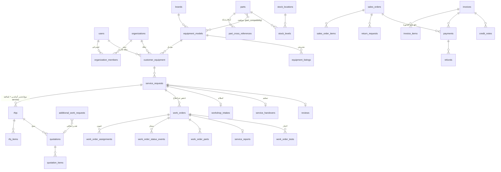

# 🗄️ نموذج البيانات
## منصة ضواحي البادية للمعدات الثقيلة

**الإصدار:** 1.0 (مسودة)
**التاريخ:** 2026-11-15
**قاعدة البيانات:** MySQL 8.4 LTS بمحرك InnoDB وترميز `utf8mb4` وترتيب `utf8mb4_0900_ai_ci` (ADR-02)
**المرجعية:** الحالات (status) مطابقة حرفياً لآلات الحالات في [02_workflows_states.md](02_workflows_states.md)، وقواعد العمل في [01_srs.md](01_srs.md) §5.

---

## 📌 جدول المحتويات

1. [اصطلاحات عامة](#1-اصطلاحات-عامة)
2. [مخطط العلاقات المختصر](#2-مخطط-العلاقات-المختصر)
3. [الهوية والحسابات](#3-الهوية-والحسابات)
4. [الفروع والكتالوج](#4-الفروع-والكتالوج)
5. [القطع والمخزون](#5-القطع-والمخزون)
6. [أسطول العميل](#6-أسطول-العميل)
7. [عروض الأسعار](#7-عروض-الأسعار)
8. [طلبات القطع والإرجاع](#8-طلبات-القطع-والإرجاع)
9. [الصيانة وأوامر العمل](#9-الصيانة-وأوامر-العمل)
10. [المالية](#10-المالية)
11. [المراسلات والإشعارات](#11-المراسلات-والإشعارات)
12. [المحتوى والنظام](#12-المحتوى-والنظام)
13. [قواعد الرؤية والفهارس](#13-قواعد-الرؤية-والفهارس)

---

## 1. اصطلاحات عامة

| البند | القاعدة |
|-------|---------|
| المخطط الفعلي | جمل `CREATE TABLE` هنا **توضيحية**: المخطط الفعلي يُبنى بـ Laravel Migrations، وكل مفتاح أجنبي يُكتب قيداً صريحاً (`foreignUuid(...)->constrained()`)، لأن MySQL يتجاهل `REFERENCES` المكتوبة داخل تعريف العمود |
| المفاتيح | `id CHAR(36)` بصيغة UUIDv7 (قابل للترتيب زمنياً، `HasUuids` في Laravel) يُولَّد في الخادم، أو في تطبيق الفني للسجلات المنشأة بدون اتصال |
| الأرقام المقروءة | عمود `number` منفصل عن `id` (BR-14). أرقام الفواتير من جدول `number_sequences` بقفل صف لضمان التسلسل المتصل |
| المال | `DECIMAL(12,3)` بالريال العُماني، و `currency CHAR(3) DEFAULT 'OMR'`. **لا `float` أبداً**، والحساب في PHP بمكتبة `brick/math` لا بأرقام PHP العائمة. الضريبة تُحسب لكل سطر وتُقرّب نصفاً للأعلى لأقرب 0.001 (BR-01) |
| الوقت | `DATETIME(6)` مخزن بـ UTC (منطقة الاتصال `+00:00` ومنطقة التطبيق UTC). لا `TIMESTAMP` لحد عام 2038. التواريخ التجارية (`valid_until`، `due_date`) من نوع `DATE` وتُفسَّر بتوقيت Asia/Muscat |
| الحالات | `VARCHAR(30)` مع `CHECK (status IN (...))`، أسهل في الترحيل من `ENUM`. قيود `CHECK` مفعّلة في MySQL منذ 8.0.16 |
| النصوص | `VARCHAR(n)` لكل عمود عليه فهرس أو `UNIQUE`، و `TEXT` للنصوص الحرة فقط. البريد لا يحتاج `CITEXT` لأن الترتيب `_ai_ci` لا يميز حالة الأحرف |
| بنى خاصة | المصفوفات والقوائم `JSON`. الموقع `POINT SRID 4326` مع فهرس `SPATIAL`. الكلمات المحجوزة في MySQL (`key`، `values`، `condition`، `before`، `last_value`) بين علامتي `` ` `` |
| النصوص ثنائية اللغة | عمودان `_ar` و `_en` للمحتوى الذي تديره الشركة. نصوص العميل تُخزن كما كُتبت |
| النسخ الثابتة (Snapshot) | الأسعار والضريبة والعناوين وبيانات الطرفين تُنسخ في المستندات لحظة إنشائها (BR-17) |
| الارتباط بمصدر واحد | عند وجود أكثر من مفتاح أجنبي اختياري يُضاف قيد `CHECK (((a IS NOT NULL) + (b IS NOT NULL) + (c IS NOT NULL)) = 1)` |
| الشرط الفريد الجزئي | MySQL لا يدعم `CREATE UNIQUE INDEX ... WHERE`. البديل عمود مولّد قيمته `NULL` خارج الشرط مع `UNIQUE` عليه (يسمح بتعدد `NULL`) |
| الحالات المشتقة | لا تُخزن (BR-15). المجاميع المخزنة (`amount_paid`، `stock_levels`) إسقاطات تُحدَّث في نفس المعاملة (Transaction) |
| التزامن | أعمدة `version INT` على الكيانات التي يعدّلها أكثر من طرف (أوامر العمل، العروض) للقفل المتفائل |
| الحذف | لا حذف فعلي للسجلات التجارية. الأرشفة عبر الحالة، والمستخدم بحذف منطقي ثم تجهيل (BR-16) |
| الأعمدة القياسية | `created_at`، `updated_at` في كل جدول (محذوفة من الجداول أدناه اختصاراً) |

---

## 2. مخطط العلاقات المختصر



---

## 3. الهوية والحسابات

```sql
CREATE TABLE users (
  id                CHAR(36) PRIMARY KEY,
  user_type         VARCHAR(30) NOT NULL CHECK (user_type IN ('customer','staff')),
  full_name         VARCHAR(255) NOT NULL,
  phone_e164        VARCHAR(20) UNIQUE,           -- +968XXXXXXXX، إلزامي للعملاء
  phone_verified_at DATETIME(6),
  email             VARCHAR(255) UNIQUE,                -- إلزامي للموظفين
  email_verified_at DATETIME(6),
  password_hash     VARCHAR(255),                 -- Argon2id، اختياري للعملاء
  preferred_locale  VARCHAR(30) NOT NULL DEFAULT 'ar' CHECK (preferred_locale IN ('ar','en')),
  avatar_id         CHAR(36) REFERENCES attachments(id),
  status            VARCHAR(30) NOT NULL DEFAULT 'active' CHECK (status IN ('active','suspended','deleted')),
  suspended_reason  TEXT,
  last_login_at     DATETIME(6),
  pickup_no_show_count SMALLINT NOT NULL DEFAULT 0, -- 02 §10: يُعلَّم للمراجعة عند 3
  internal_flag_at  DATETIME(6),                   -- تعليم للمراجعة في A-12
  deleted_at        DATETIME(6),
  anonymized_at     DATETIME(6),                  -- BR-16
  CHECK (user_type <> 'customer' OR phone_e164 IS NOT NULL OR anonymized_at IS NOT NULL),
  CHECK (user_type <> 'staff'    OR email IS NOT NULL)
);

CREATE TABLE staff_profiles (
  user_id        CHAR(36) PRIMARY KEY REFERENCES users(id),
  employee_no    VARCHAR(50) UNIQUE NOT NULL,
  branch_id      CHAR(36) NOT NULL REFERENCES branches(id),
  restrict_to_branch BOOLEAN NOT NULL DEFAULT false,
  skills          JSON NOT NULL DEFAULT (JSON_ARRAY()),  -- مهارات الفني وماركاته للفلترة في A-10 و A-11 (مثل hydraulic_cylinder، cat_engines)
  totp_secret_enc TEXT,                                   -- مشفر بمفتاح التطبيق (cast "encrypted" في Laravel)
  totp_enabled_at DATETIME(6)                    -- NFR-08
);

CREATE TABLE user_roles (
  user_id CHAR(36) REFERENCES users(id),
  role    VARCHAR(30) CHECK (role IN ('sales','service_coordinator','technician',
                               'parts_staff','accountant','content_editor','admin')),
  PRIMARY KEY (user_id, role)
);

CREATE TABLE otp_challenges (                    -- FR-AUTH-05
  id           CHAR(36) PRIMARY KEY,
  phone_e164   VARCHAR(20) NOT NULL,
  purpose      VARCHAR(30) NOT NULL CHECK (purpose IN ('login','register','change_phone','invite','delete_account')),  -- login يشمل التسجيل (مسار واحد، US-06)
  code_hash    VARCHAR(255) NOT NULL,
  expires_at   DATETIME(6) NOT NULL,              -- +5 دقائق
  attempts     SMALLINT NOT NULL DEFAULT 0,       -- القفل عند 5
  consumed_at  DATETIME(6),
  ip           VARCHAR(45)
);

CREATE TABLE devices (
  id           CHAR(36) PRIMARY KEY,
  user_id      CHAR(36) NOT NULL REFERENCES users(id),
  app          VARCHAR(30) NOT NULL CHECK (app IN ('customer','technician','web')),
  platform     VARCHAR(30) NOT NULL CHECK (platform IN ('android','ios','web')),
  push_token   VARCHAR(255),
  app_version  VARCHAR(255),
  status       VARCHAR(30) NOT NULL DEFAULT 'active' CHECK (status IN ('active','revoked')),
  last_seen_at DATETIME(6)
);

CREATE TABLE device_activation_codes (           -- FR-AUTH-03: ربط جهاز فني جديد = العامل الثاني
  id           CHAR(36) PRIMARY KEY,
  user_id      CHAR(36) NOT NULL REFERENCES users(id),   -- الفني
  code_hash    VARCHAR(255) NOT NULL,
  expires_at   DATETIME(6) NOT NULL,              -- +24 ساعة
  issued_by    CHAR(36) NOT NULL REFERENCES users(id),
  consumed_at  DATETIME(6),
  device_id    CHAR(36) REFERENCES devices(id),       -- الجهاز الذي رُبط به (مرة واحدة)
  CHECK ((consumed_at IS NULL) = (device_id IS NULL))
);

CREATE TABLE sessions (                          -- FR-AUTH-04، 04 §5
  id                 CHAR(36) PRIMARY KEY,
  user_id            CHAR(36) NOT NULL REFERENCES users(id),
  device_id          CHAR(36) REFERENCES devices(id),
  client             VARCHAR(30) NOT NULL CHECK (client IN ('web','admin','customer_app','technician_app')),  -- يحدد مدة الجلسة
  remember           BOOLEAN NOT NULL DEFAULT false, -- "تذكرني" في الويب (FR-AUTH-02)
  refresh_token_hash VARCHAR(64) UNIQUE NOT NULL, -- SHA-256، تدوير عند كل استخدام
  previous_refresh_token_hash VARCHAR(64),        -- مهلة 30 ثانية للطلبات المتزامنة، وما بعدها إعادة استخدام تلغي كل الجلسات
  rotated_at         DATETIME(6),
  ip                 VARCHAR(45),
  user_agent         TEXT,
  last_used_at       DATETIME(6),                 -- خمول الإدارة 30 دقيقة (NFR-08)
  expires_at         DATETIME(6) NOT NULL,
  revoked_at         DATETIME(6),
  revoked_reason     VARCHAR(30)                  -- logout، user_revoked، reuse_detected، idle، account_suspended...
);
-- رمز الوصول القصير (Sanctum، جدول personal_access_tokens) يحمل session_id، فإنهاء الجلسة يلغي رموزها فوراً.
-- password_reset_tokens (جدول Laravel القياسي): استعادة كلمة المرور وتفعيل حساب الموظف الجديد (US-39).

CREATE TABLE consents (                          -- NFR-13
  id         CHAR(36) PRIMARY KEY,
  user_id    CHAR(36) NOT NULL REFERENCES users(id),
  kind       VARCHAR(30) NOT NULL CHECK (kind IN ('terms','privacy','marketing')),
  version    VARCHAR(50) NOT NULL,
  granted    BOOLEAN NOT NULL,
  ip         VARCHAR(45),
  created_at DATETIME(6) NOT NULL               -- سجل إلحاقي، لا تعديل
);

CREATE TABLE organizations (                     -- FR-ACC-02، FR-ACC-03
  id                  CHAR(36) PRIMARY KEY,
  name                VARCHAR(255) NOT NULL,
  cr_number           VARCHAR(255) UNIQUE,
  cr_expiry_date      DATE,
  vat_number          VARCHAR(255),
  governorate         VARCHAR(50) NOT NULL,      -- رمز من قائمة المحافظات (01 §2)
  verification_status VARCHAR(30) NOT NULL DEFAULT 'unverified'
                      CHECK (verification_status IN ('unverified','pending','verified','rejected')),
  verified_by         CHAR(36) REFERENCES users(id),
  verified_at         DATETIME(6),
  rejection_reason    TEXT,
  credit_limit        DECIMAL(12,3) NOT NULL DEFAULT 0,   -- BR-08
  payment_terms_days  INT NOT NULL DEFAULT 0,
  preapproval_limit   DECIMAL(12,3) NOT NULL DEFAULT 0,   -- BR-06
  internal_notes      TEXT
);

CREATE TABLE organization_members (
  organization_id    CHAR(36) REFERENCES organizations(id),
  user_id            CHAR(36) REFERENCES users(id),
  role               VARCHAR(30) NOT NULL CHECK (role IN ('owner','member')),
  can_approve_quotes BOOLEAN NOT NULL DEFAULT false,      -- دائماً true للمالك
  joined_at          DATETIME(6) NOT NULL,
  removed_at         DATETIME(6),
  PRIMARY KEY (organization_id, user_id)
);
-- قاعدة في الخدمة: لا يُزال آخر مالك نشط.

CREATE TABLE organization_invitations (
  id                 CHAR(36) PRIMARY KEY,
  organization_id    CHAR(36) NOT NULL REFERENCES organizations(id),
  phone_e164         VARCHAR(20) NOT NULL,
  role               VARCHAR(30) NOT NULL CHECK (role IN ('owner','member')),
  can_approve_quotes BOOLEAN NOT NULL DEFAULT false,
  token_hash         VARCHAR(255) UNIQUE NOT NULL,
  status             VARCHAR(30) NOT NULL CHECK (status IN ('pending','accepted','expired','revoked')),
  expires_at         DATETIME(6) NOT NULL,          -- +7 أيام
  invited_by         CHAR(36) NOT NULL REFERENCES users(id)
);

CREATE TABLE addresses (                          -- FR-ACC-04
  id              CHAR(36) PRIMARY KEY,
  user_id         CHAR(36) REFERENCES users(id),
  organization_id CHAR(36) REFERENCES organizations(id),
  label           VARCHAR(255) NOT NULL,          -- "محجر الخوض"
  kind            VARCHAR(30) NOT NULL CHECK (kind IN ('delivery','site','both')),
  governorate     VARCHAR(50) NOT NULL,
  wilayat         VARCHAR(50) NOT NULL,
  description     TEXT,                           -- وصف الوصول
  location        POINT NOT NULL SRID 4326,
  contact_name    VARCHAR(255),
  contact_phone   VARCHAR(20),
  archived_at     DATETIME(6),
  CHECK (((user_id IS NOT NULL) + (organization_id IS NOT NULL)) = 1)
);
```

---

## 4. الفروع والكتالوج

```sql
CREATE TABLE branches (                           -- FR-ADM-02
  id                   CHAR(36) PRIMARY KEY,
  code                 VARCHAR(50) UNIQUE NOT NULL,
  name_ar              VARCHAR(255) NOT NULL,
  name_en              VARCHAR(255) NOT NULL,
  governorate          VARCHAR(50) NOT NULL,
  wilayat              VARCHAR(50) NOT NULL,
  address_ar           TEXT,
  address_en           TEXT,
  location             POINT NOT NULL SRID 4326,
  phone                VARCHAR(20),
  whatsapp_sales       VARCHAR(255),
  whatsapp_service     VARCHAR(255),
  whatsapp_parts       VARCHAR(255),
  email                VARCHAR(255),
  working_hours        JSON NOT NULL,            -- للعرض فقط، أما SLA ففي settings
  covered_governorates JSON NOT NULL,
  is_active            BOOLEAN NOT NULL DEFAULT true
);

CREATE TABLE brands (
  id             CHAR(36) PRIMARY KEY,
  name           VARCHAR(255) NOT NULL,
  slug           VARCHAR(255) UNIQUE NOT NULL,
  logo_id        CHAR(36) REFERENCES attachments(id),
  is_represented BOOLEAN NOT NULL DEFAULT false,  -- وكيل معتمد (Q-10)
  sort_order     INT NOT NULL DEFAULT 0,
  is_active      BOOLEAN NOT NULL DEFAULT true
);

CREATE TABLE equipment_categories (
  id         CHAR(36) PRIMARY KEY,
  parent_id  CHAR(36) REFERENCES equipment_categories(id),
  name_ar    VARCHAR(255) NOT NULL,
  name_en    VARCHAR(255) NOT NULL,
  slug       VARCHAR(255) UNIQUE NOT NULL,
  icon       VARCHAR(255),
  sort_order INT NOT NULL DEFAULT 0
);

CREATE TABLE equipment_models (
  id                  CHAR(36) PRIMARY KEY,
  brand_id            CHAR(36) NOT NULL REFERENCES brands(id),
  category_id         CHAR(36) NOT NULL REFERENCES equipment_categories(id),
  model_name          VARCHAR(255) NOT NULL,
  slug                VARCHAR(255) UNIQUE NOT NULL,
  -- المواصفات القابلة للفلترة أعمدة حقيقية (FR-CAT-02):
  operating_weight_kg INT,
  engine_power_kw     DECIMAL(7,1),
  bucket_capacity_m3  DECIMAL(5,2),
  lifting_capacity_kg INT,
  -- مواصفات للعرض فقط:
  specs               JSON NOT NULL DEFAULT (JSON_OBJECT()),   -- [{key, label_ar, label_en, value, unit}]
  spec_sheet_id       CHAR(36) REFERENCES attachments(id),
  UNIQUE (brand_id, model_name)
);

CREATE TABLE equipment_listings (                 -- FR-CAT-01، FR-CAT-06، BR-03
  id               CHAR(36) PRIMARY KEY,
  listing_kind     VARCHAR(30) NOT NULL DEFAULT 'machine' CHECK (listing_kind IN ('machine','component','scrap')),
  model_id         CHAR(36) REFERENCES equipment_models(id),   -- للآلة والسكراب
  component_type   VARCHAR(255),                  -- للمكوّن: diesel_engine, transmission, hydraulic_pump, arm, bucket, other
  component_model  VARCHAR(255),                  -- مثل "CAT 3306"، "ZF 4WG200"
  source_machine   VARCHAR(255),                  -- الآلة المصدر إن عُرفت، مثل "حفار Volvo EC360"
  missing_parts    TEXT,                          -- للسكراب: مثل "بدون محرك وجير"
  `condition`        VARCHAR(30) NOT NULL CHECK (`condition` IN ('new','used','rebuilt','for_parts')),
  warranty_months  SMALLINT CHECK (warranty_months >= 0),   -- FR-CAT-07
  year             SMALLINT,
  hour_meter       INT,
  serial_number    VARCHAR(255),
  slug             VARCHAR(255) UNIQUE NOT NULL,
  title_ar         VARCHAR(255) NOT NULL,
  title_en         VARCHAR(255) NOT NULL,
  description_ar   TEXT,
  description_en   TEXT,
  price            DECIMAL(12,3),
  price_visibility VARCHAR(30) NOT NULL CHECK (price_visibility IN ('shown','on_request')),
  branch_id        CHAR(36) NOT NULL REFERENCES branches(id),
  status           VARCHAR(30) NOT NULL DEFAULT 'draft'
                   CHECK (status IN ('draft','published','reserved','sold','archived')),
  reserved_for_rfq_id CHAR(36) REFERENCES rfqs(id),    -- BR-19: الطلب الذي قُبل عرضه
  is_featured      BOOLEAN NOT NULL DEFAULT false, -- "معدات مميزة" في W-01 و M-06
  published_at     DATETIME(6),
  created_by       CHAR(36) NOT NULL REFERENCES users(id),
  CHECK (price_visibility = 'on_request' OR price IS NOT NULL),
  CHECK (reserved_for_rfq_id IS NULL OR status IN ('reserved','sold')),   -- الحجز اليدوي ممكن دون طلب (A-02)
  CHECK ((listing_kind = 'component') = (component_model IS NOT NULL)),
  CHECK (listing_kind = 'component' OR model_id IS NOT NULL),
  CHECK ((listing_kind = 'scrap') = (`condition` = 'for_parts')),
  CHECK (listing_kind <> 'machine' OR `condition` = 'new' OR (year IS NOT NULL AND hour_meter IS NOT NULL)),  -- BR-03
  CHECK (listing_kind <> 'scrap' OR year IS NOT NULL)
);

CREATE TABLE listing_media (
  listing_id    CHAR(36) REFERENCES equipment_listings(id),
  attachment_id CHAR(36) REFERENCES attachments(id),
  sort_order    INT NOT NULL,
  PRIMARY KEY (listing_id, attachment_id)
);
```

---

## 5. القطع والمخزون

```sql
CREATE TABLE parts (                              -- FR-PRT-01..04
  id                     CHAR(36) PRIMARY KEY,
  brand_id               CHAR(36) NOT NULL REFERENCES brands(id),
  part_number            VARCHAR(255) NOT NULL,   -- كما هو من المصنع
  part_number_normalized VARCHAR(255) GENERATED ALWAYS AS
                         (UPPER(REGEXP_REPLACE(part_number, '[^A-Za-z0-9]', ''))) STORED,
  name_ar                VARCHAR(255) NOT NULL,
  name_en                VARCHAR(255) NOT NULL,
  description_ar         TEXT,
  description_en         TEXT,
  category               VARCHAR(255),            -- فلاتر، زيوت، هيدروليك، محرك...
  unit                   VARCHAR(30) NOT NULL CHECK (unit IN ('piece','set','liter','meter','kg')),
  price                  DECIMAL(12,3) NOT NULL,
  vat_rate               DECIMAL(5,2) NOT NULL DEFAULT 5.00,
  is_returnable          BOOLEAN NOT NULL DEFAULT true,   -- BR-12
  warranty_months        SMALLINT CHECK (warranty_months >= 0),   -- FR-CAT-07، مثل 12 لأنظمة القلابات
  weight_kg              DECIMAL(8,2),
  is_active              BOOLEAN NOT NULL DEFAULT true,
  erp_ref                VARCHAR(255) UNIQUE,     -- P2
  UNIQUE (brand_id, part_number_normalized)
);

CREATE TABLE part_cross_references (
  id                    CHAR(36) PRIMARY KEY,
  part_id               CHAR(36) NOT NULL REFERENCES parts(id),
  alt_number            VARCHAR(255) NOT NULL,
  alt_number_normalized VARCHAR(255) GENERATED ALWAYS AS
                        (UPPER(REGEXP_REPLACE(alt_number, '[^A-Za-z0-9]', ''))) STORED,
  alt_brand             VARCHAR(255),
  UNIQUE (part_id, alt_number_normalized)
);

CREATE TABLE part_compatibility (
  part_id  CHAR(36) REFERENCES parts(id),
  model_id CHAR(36) REFERENCES equipment_models(id),
  notes    TEXT,                                  -- "من الرقم التسلسلي ... فما فوق"
  PRIMARY KEY (part_id, model_id)
);

CREATE TABLE part_media (
  part_id       CHAR(36) REFERENCES parts(id),
  attachment_id CHAR(36) REFERENCES attachments(id),
  sort_order    INT NOT NULL,
  PRIMARY KEY (part_id, attachment_id)
);

CREATE TABLE stock_locations (                    -- مخازن الفرع (لا مخزون مركبات، العمل في الورشة فقط)
  id                 CHAR(36) PRIMARY KEY,
  branch_id          CHAR(36) NOT NULL REFERENCES branches(id),
  name               VARCHAR(255) NOT NULL         -- "المخزن الرئيسي"، "رف الورشة"
);

CREATE TABLE stock_levels (                       -- إسقاط من stock_movements
  part_id      CHAR(36) REFERENCES parts(id),
  location_id  CHAR(36) REFERENCES stock_locations(id),
  qty_on_hand  DECIMAL(12,2) NOT NULL DEFAULT 0 CHECK (qty_on_hand >= 0),
  qty_reserved DECIMAL(12,2) NOT NULL DEFAULT 0 CHECK (qty_reserved >= 0),
  PRIMARY KEY (part_id, location_id),
  CHECK (qty_reserved <= qty_on_hand)
);

CREATE TABLE stock_movements (                    -- دفتر إلحاقي، لا تعديل ولا حذف
  id                CHAR(36) PRIMARY KEY,
  part_id           CHAR(36) NOT NULL REFERENCES parts(id),
  location_id       CHAR(36) NOT NULL REFERENCES stock_locations(id),
  qty_delta         DECIMAL(12,2) NOT NULL CHECK (qty_delta <> 0),
  reason            VARCHAR(30) NOT NULL CHECK (reason IN
                    ('receipt','sale','work_order','return','adjustment','transfer_in','transfer_out')),
  sales_order_id    CHAR(36) REFERENCES sales_orders(id),
  work_order_id     CHAR(36) REFERENCES work_orders(id),
  return_request_id CHAR(36) REFERENCES return_requests(id),
  note              TEXT,
  created_by        CHAR(36) NOT NULL REFERENCES users(id),
  created_at        DATETIME(6) NOT NULL,
  CHECK (((sales_order_id IS NOT NULL) + (work_order_id IS NOT NULL) + (return_request_id IS NOT NULL)) <= 1)
);
```

> **مستوى التوفر للعميل (BR-04)** يُحسب من `sum(qty_on_hand - qty_reserved)` في مواقع نوع `branch` فقط، ولا يُعرض الرقم.

---

## 6. أسطول العميل

```sql
CREATE TABLE customer_equipment (                 -- FR-ACC-05
  id                    CHAR(36) PRIMARY KEY,
  organization_id       CHAR(36) REFERENCES organizations(id),
  owner_user_id         CHAR(36) REFERENCES users(id),
  model_id              CHAR(36) REFERENCES equipment_models(id),
  brand_text            VARCHAR(255),             -- إن لم يكن الموديل في الكتالوج
  model_text            VARCHAR(255),
  serial_number         VARCHAR(255),
  year                  SMALLINT,
  nickname              VARCHAR(255),             -- "الحفار رقم 3"
  current_hour_meter    INT CHECK (current_hour_meter >= 0),
  hour_meter_updated_at DATETIME(6),
  site_address_id       CHAR(36) REFERENCES addresses(id),
  warranty_until        DATE,                     -- FR-SRV-07 (P2)
  archived_at           DATETIME(6),
  CHECK (((organization_id IS NOT NULL) + (owner_user_id IS NOT NULL)) = 1),
  CHECK (model_id IS NOT NULL OR model_text IS NOT NULL)
);

CREATE TABLE hour_meter_readings (
  id                    CHAR(36) PRIMARY KEY,
  customer_equipment_id CHAR(36) NOT NULL REFERENCES customer_equipment(id),
  reading               INT NOT NULL CHECK (reading >= 0),
  source                VARCHAR(30) NOT NULL CHECK (source IN ('customer','intake','technician','telematics')),
  work_order_id         CHAR(36) REFERENCES work_orders(id),
  photo_id              CHAR(36) REFERENCES attachments(id),
  recorded_by           CHAR(36) REFERENCES users(id),
  recorded_at           DATETIME(6) NOT NULL
);
-- قراءة أقل من السابقة: تُقبل مع تحذير وعلامة "تحتاج مراجعة" (تبديل عداد).
```

---

## 7. عروض الأسعار

```sql
CREATE TABLE rfqs (                               -- SM-1
  id                  CHAR(36) PRIMARY KEY,
  number              VARCHAR(50) UNIQUE NOT NULL, -- RFQ-2026-000123
  type                VARCHAR(30) NOT NULL CHECK (type IN ('equipment','parts','service')),
  customer_user_id    CHAR(36) NOT NULL REFERENCES users(id),
  organization_id     CHAR(36) REFERENCES organizations(id),
  status              VARCHAR(30) NOT NULL CHECK (status IN
                      ('submitted','in_review','quoted','won','lost','cancelled')),
  source              VARCHAR(30) NOT NULL CHECK (source IN ('web','app','whatsapp','phone','walk_in','system')), -- system: تقدير صيانة (02 SM-1 انتقال 1.1b)
  assigned_to         CHAR(36) REFERENCES users(id),
  branch_id           CHAR(36) REFERENCES branches(id),
  service_request_id  CHAR(36) REFERENCES service_requests(id),
  is_additional       BOOLEAN NOT NULL DEFAULT false,   -- تقدير عمل إضافي (02 SM-4 جدول 4a)
  delivery_address_id CHAR(36) REFERENCES addresses(id),
  delivery_country    CHAR(2) NOT NULL DEFAULT 'OM',   -- ISO، للتصدير (مثل SY)، ويؤثر على نسبة الضريبة (BR-01)
  notes               TEXT,
  lost_reason         TEXT,                       -- 'expired' عند انتهاء آخر نسخة (2.6)، ويسمح للعميل بإعادة الفتح (1.9)
  CHECK ((type = 'service') = (service_request_id IS NOT NULL)),
  CHECK (NOT is_additional OR type = 'service')
);
-- تقدير أساسي واحد فقط لكل طلب صيانة، والإضافية بلا حد:
ALTER TABLE rfqs
  ADD COLUMN primary_service_key CHAR(36) GENERATED ALWAYS AS
      (CASE WHEN type = 'service' AND NOT is_additional THEN service_request_id END) STORED,
  ADD UNIQUE KEY one_primary_service_rfq (primary_service_key);

CREATE TABLE rfq_items (
  id         CHAR(36) PRIMARY KEY,
  rfq_id     CHAR(36) NOT NULL REFERENCES rfqs(id),
  listing_id CHAR(36) REFERENCES equipment_listings(id),
  part_id    CHAR(36) REFERENCES parts(id),
  free_text  TEXT,                                -- قطعة غير مدرجة: رقمها أو وصفها (FR-PRT-05)
  specs      JSON,                               -- نموذج مواصفات السلندر (FR-RFQ-01): bore_mm, rod_mm, stroke_mm, mounting, pressure_bar
  quantity   DECIMAL(12,2) NOT NULL CHECK (quantity > 0),
  CHECK (((listing_id IS NOT NULL) + (part_id IS NOT NULL) + (free_text IS NOT NULL)) >= 1)
);

CREATE TABLE rfq_attachments (                    -- FR-RFQ-01، FR-PRT-05: صور القطعة أو لوحتها أو السلندر القديم
  rfq_id        CHAR(36) REFERENCES rfqs(id),
  rfq_item_id   CHAR(36) REFERENCES rfq_items(id),    -- اختياري: الصورة لبند معين
  attachment_id CHAR(36) REFERENCES attachments(id),
  PRIMARY KEY (rfq_id, attachment_id)
);

CREATE TABLE quotations (                         -- SM-2
  id                 CHAR(36) PRIMARY KEY,
  rfq_id             CHAR(36) NOT NULL REFERENCES rfqs(id),
  version            SMALLINT NOT NULL,
  number             VARCHAR(50) UNIQUE,          -- QT-2026-000045-v2، يُسند عند الإرسال
  status             VARCHAR(30) NOT NULL CHECK (status IN
                     ('draft','sent','accepted','rejected','revision_requested','expired','superseded')),
  valid_until        DATE,
  currency           CHAR(3) NOT NULL DEFAULT 'OMR',
  subtotal           DECIMAL(12,3) NOT NULL DEFAULT 0,
  discount_total     DECIMAL(12,3) NOT NULL DEFAULT 0,
  vat_total          DECIMAL(12,3) NOT NULL DEFAULT 0,
  total              DECIMAL(12,3) NOT NULL DEFAULT 0,
  estimated_duration VARCHAR(255),                -- للصيانة: "يومان"
  delivery_terms     TEXT,
  warranty_terms     TEXT,
  payment_terms      TEXT,
  sent_by            CHAR(36) REFERENCES users(id),
  sent_at            DATETIME(6),
  responded_by       CHAR(36) REFERENCES users(id),
  responded_at       DATETIME(6),
  response_note      TEXT,                        -- سبب الرفض أو ملاحظة التعديل
  lpo_number         VARCHAR(255),                -- FR-RFQ-03
  lpo_attachment_id  CHAR(36) REFERENCES attachments(id),
  pdf_id             CHAR(36) REFERENCES attachments(id),
  version_lock       INT NOT NULL DEFAULT 0,      -- قفل متفائل
  UNIQUE (rfq_id, version),
  CHECK (status = 'draft' OR (valid_until IS NOT NULL AND number IS NOT NULL))
);
-- نسخة فعالة واحدة فقط لكل طلب:
ALTER TABLE quotations
  ADD COLUMN sent_rfq_key CHAR(36) GENERATED ALWAYS AS
      (CASE WHEN status = 'sent' THEN rfq_id END) STORED,
  ADD UNIQUE KEY one_sent_quotation_per_rfq (sent_rfq_key);

CREATE TABLE quotation_items (                    -- نسخة ثابتة BR-17
  id              CHAR(36) PRIMARY KEY,
  quotation_id    CHAR(36) NOT NULL REFERENCES quotations(id),
  line_no         SMALLINT NOT NULL,
  item_type       VARCHAR(30) NOT NULL CHECK (item_type IN ('equipment','part','labor','service_fee','other')),
  listing_id      CHAR(36) REFERENCES equipment_listings(id),
  part_id         CHAR(36) REFERENCES parts(id),
  description_ar  TEXT NOT NULL,
  description_en  TEXT NOT NULL,
  quantity        DECIMAL(12,2) NOT NULL CHECK (quantity > 0),
  unit            VARCHAR(255) NOT NULL,
  unit_price      DECIMAL(12,3) NOT NULL CHECK (unit_price >= 0),
  discount_amount DECIMAL(12,3) NOT NULL DEFAULT 0,
  vat_rate        DECIMAL(5,2) NOT NULL,          -- 0 للتصدير بعد مراجعة المحاسب (BR-01)
  warranty_months SMALLINT,                        -- نسخة ثابتة (FR-CAT-07، BR-17)
  line_subtotal   DECIMAL(12,3) NOT NULL,          -- qty × price − discount
  line_vat        DECIMAL(12,3) NOT NULL,          -- round_half_up(subtotal × rate / 100, 3)
  line_total      DECIMAL(12,3) NOT NULL,
  UNIQUE (quotation_id, line_no)
);
```

---

## 8. طلبات القطع والإرجاع

```sql
CREATE TABLE carts      (id CHAR(36) PRIMARY KEY, user_id CHAR(36) UNIQUE NOT NULL REFERENCES users(id));
CREATE TABLE cart_items (cart_id CHAR(36) REFERENCES carts(id), part_id CHAR(36) REFERENCES parts(id),
                         quantity DECIMAL(12,2) NOT NULL CHECK (quantity > 0),
                         PRIMARY KEY (cart_id, part_id));

CREATE TABLE sales_orders (                       -- SM-3a
  id                 CHAR(36) PRIMARY KEY,
  number             VARCHAR(50) UNIQUE NOT NULL, -- SO-2026-000310
  customer_user_id   CHAR(36) NOT NULL REFERENCES users(id),
  organization_id    CHAR(36) REFERENCES organizations(id),
  rfq_id             CHAR(36) REFERENCES rfqs(id),    -- إن جاء من عرض قطع مقبول
  status             VARCHAR(30) NOT NULL CHECK (status IN ('pending_payment','confirmed','processing',
                     'ready_for_pickup','out_for_delivery','delivered','cancelled')),
  fulfillment        VARCHAR(30) NOT NULL CHECK (fulfillment IN ('delivery','pickup')),
  branch_id          CHAR(36) NOT NULL REFERENCES branches(id),
  delivery_address   JSON,                       -- نسخة ثابتة
  payment_method     VARCHAR(30) NOT NULL CHECK (payment_method IN
                     ('pay_on_fulfillment',       -- P1: الدفع عند الاستلام أو التسليم (BR-18)
                      'credit',                   -- P2: آجل لشركة موثقة (BR-08)
                      'online')),                 -- P3: بوابة الدفع
  phone_confirmed_at DATETIME(6),                 -- BR-18: تأكيد هاتفي للتوصيل فوق المبلغ المحدد
  pickup_deadline_at DATETIME(6),                 -- BR-05: يُضبط عند ready_for_pickup
  subtotal           DECIMAL(12,3) NOT NULL,
  vat_total          DECIMAL(12,3) NOT NULL,
  delivery_fee       DECIMAL(12,3) NOT NULL DEFAULT 0,  -- قبل الضريبة. ضريبته ضمن vat_total، ويظهر سطراً مستقلاً في الفاتورة (BR-01)
  total              DECIMAL(12,3) NOT NULL,
  currency           CHAR(3) NOT NULL DEFAULT 'OMR',
  payment_expires_at DATETIME(6),                 -- BR-05 (P3)
  pickup_code_hash   VARCHAR(255),
  cancel_reason      TEXT,
  delivered_at       DATETIME(6),
  proof_id           CHAR(36) REFERENCES attachments(id),
  CHECK (fulfillment = 'pickup' OR delivery_address IS NOT NULL),
  CHECK (payment_method = 'online' OR status <> 'pending_payment'),
  CHECK (payment_method <> 'online' OR status <> 'pending_payment' OR payment_expires_at IS NOT NULL),
  CHECK (status <> 'ready_for_pickup' OR pickup_deadline_at IS NOT NULL)
);
-- قاعدة في الخدمة (BR-18): الانتقال إلى delivered لطلب pay_on_fulfillment يتطلب دفعة succeeded
-- بالإجمالي في نفس المعاملة، ثم إصدار الفاتورة.

CREATE TABLE sales_order_items (
  id                   CHAR(36) PRIMARY KEY,
  order_id             CHAR(36) NOT NULL REFERENCES sales_orders(id),
  part_id              CHAR(36) NOT NULL REFERENCES parts(id),
  part_number_snapshot VARCHAR(255) NOT NULL,
  name_ar_snapshot     VARCHAR(255) NOT NULL,
  name_en_snapshot     VARCHAR(255) NOT NULL,
  is_returnable        BOOLEAN NOT NULL,
  warranty_months      SMALLINT,                   -- نسخة ثابتة (FR-CAT-07)
  quantity             DECIMAL(12,2) NOT NULL CHECK (quantity > 0),
  unit_price           DECIMAL(12,3) NOT NULL,     -- من الكتالوج، أو من العرض المقبول (SM-3a انتقال 3.14)
  vat_rate             DECIMAL(5,2) NOT NULL,
  line_subtotal        DECIMAL(12,3) NOT NULL,
  line_vat             DECIMAL(12,3) NOT NULL,
  line_total           DECIMAL(12,3) NOT NULL,
  stock_location_id    CHAR(36) NOT NULL REFERENCES stock_locations(id)
);

CREATE TABLE return_requests (                    -- SM-3b
  id          CHAR(36) PRIMARY KEY,
  order_id    CHAR(36) NOT NULL REFERENCES sales_orders(id),
  status      VARCHAR(30) NOT NULL CHECK (status IN ('requested','approved','rejected','received','refunded')),
  reason      TEXT NOT NULL,
  decision_note TEXT,
  created_by  CHAR(36) NOT NULL REFERENCES users(id),
  decided_by  CHAR(36) REFERENCES users(id)
);
CREATE TABLE return_request_attachments (         -- FR-ORD-05: صور القطعة المرتجعة
  return_request_id CHAR(36) REFERENCES return_requests(id),
  attachment_id     CHAR(36) REFERENCES attachments(id),
  PRIMARY KEY (return_request_id, attachment_id)
);
CREATE TABLE return_request_items (
  return_request_id CHAR(36) REFERENCES return_requests(id),
  order_item_id     CHAR(36) REFERENCES sales_order_items(id),
  quantity          DECIMAL(12,2) NOT NULL CHECK (quantity > 0),
  PRIMARY KEY (return_request_id, order_item_id)
);
```

---

## 9. الصيانة وأوامر العمل

```sql
CREATE TABLE service_requests (                   -- SM-4
  id                    CHAR(36) PRIMARY KEY,
  number                VARCHAR(50) UNIQUE NOT NULL, -- SR-2026-000877
  customer_user_id      CHAR(36) NOT NULL REFERENCES users(id),
  organization_id       CHAR(36) REFERENCES organizations(id),
  customer_equipment_id CHAR(36) REFERENCES customer_equipment(id),   -- المعدة كاملة
  component_type        VARCHAR(30) CHECK (component_type IN      -- أو مكوّن منفصل يُسلَّم للورشة
                        ('diesel_engine','hydraulic_pump','hydraulic_cylinder','transmission','other')),
  component_details     TEXT,                     -- الماركة، الرقم، المعدة الأصلية
  status                VARCHAR(30) NOT NULL CHECK (status IN ('submitted','triaged','awaiting_approval',
                        'approved','in_service','completed','closed','cancelled','declined')),
  urgency               VARCHAR(30) NOT NULL CHECK (urgency IN ('normal','urgent')),
  problem_description   TEXT,                     -- نص، أو تسجيل صوتي في service_request_attachments (kind = 'voice')، ويُفرض أحدهما في الخدمة
  preferred_date        DATE,                     -- الموعد المفضل لإحضار المعدة للورشة
  source                VARCHAR(30) NOT NULL DEFAULT 'customer' CHECK (source IN ('customer','walk_in','contract')), -- walk_in: أنشأه الموظف عند الحضور، contract: P2، J-09
  contract_id           CHAR(36) REFERENCES maintenance_contracts(id),
  -- لطلب العقد: customer_user_id = جهة اتصال العقد (maintenance_contracts.contact_user_id)
  fees_acknowledged     BOOLEAN NOT NULL,          -- BR-11
  branch_id             CHAR(36) REFERENCES branches(id),
  coordinator_id        CHAR(36) REFERENCES users(id),
  route                 VARCHAR(30) CHECK (route IN ('direct_estimate','inspection','no_approval')), -- no_approval: ضمان أو عقد فقط (P2)
  sla_due_at            DATETIME(6) NOT NULL,      -- BR-09، ولطلب العقد: موعد الاستحقاق
  triaged_at            DATETIME(6),
  decline_reason        TEXT,
  cancel_reason         TEXT,
  completed_at          DATETIME(6),
  closed_at             DATETIME(6),
  CHECK (((customer_equipment_id IS NOT NULL) + (component_type IS NOT NULL)) = 1),
  CHECK (fees_acknowledged OR source = 'contract'),
  CHECK ((source = 'contract') = (contract_id IS NOT NULL))
);

CREATE TABLE service_request_attachments (
  service_request_id CHAR(36) REFERENCES service_requests(id),
  attachment_id      CHAR(36) REFERENCES attachments(id),
  kind               VARCHAR(30) NOT NULL CHECK (kind IN ('photo','video','voice')),
  PRIMARY KEY (service_request_id, attachment_id)
);

CREATE TABLE work_orders (                        -- SM-5
  id                 CHAR(36) PRIMARY KEY,
  number             VARCHAR(50) UNIQUE NOT NULL, -- WO-2026-001204
  service_request_id CHAR(36) NOT NULL REFERENCES service_requests(id),
  type               VARCHAR(30) NOT NULL CHECK (type IN ('inspection','repair','preventive','warranty')),
  status             VARCHAR(30) NOT NULL CHECK (status IN ('unassigned','scheduled',
                     'in_progress','on_hold','work_completed','verified','closed','cancelled')),
  quotation_id       CHAR(36) REFERENCES quotations(id),   -- التقدير المعتمد (BR-06)
  branch_id          CHAR(36) NOT NULL REFERENCES branches(id),
  scheduled_start    DATETIME(6),
  scheduled_end      DATETIME(6),
  on_hold_reason     VARCHAR(30) CHECK (on_hold_reason IN ('awaiting_parts','awaiting_approval',
                     'awaiting_customer','end_of_shift','other')),
  no_charge          BOOLEAN NOT NULL DEFAULT false,
  verified_by        CHAR(36) REFERENCES users(id),
  verified_at        DATETIME(6),
  closed_at          DATETIME(6),
  cancel_reason      TEXT,
  version            INT NOT NULL DEFAULT 0,
  CHECK (status IN ('unassigned','cancelled') OR scheduled_start IS NOT NULL),
  CHECK (scheduled_end IS NULL OR scheduled_end > scheduled_start),
  CHECK ((status = 'on_hold') = (on_hold_reason IS NOT NULL))
);
-- قاعدة في الخدمة (BR-20): الانتقال إلى in_progress يتطلب workshop_intakes لطلب الصيانة.

CREATE TABLE work_order_assignments (
  work_order_id      CHAR(36) REFERENCES work_orders(id),
  technician_user_id CHAR(36) REFERENCES users(id),
  role               VARCHAR(30) NOT NULL CHECK (role IN ('lead','assistant')),
  assigned_at        DATETIME(6) NOT NULL,
  unassigned_at      DATETIME(6),
  PRIMARY KEY (work_order_id, technician_user_id, assigned_at)
);
-- فني رئيسي نشط واحد لكل أمر عمل:
ALTER TABLE work_order_assignments
  ADD COLUMN active_lead_key CHAR(36) GENERATED ALWAYS AS
      (CASE WHEN role = 'lead' AND unassigned_at IS NULL THEN work_order_id END) STORED,
  ADD UNIQUE KEY one_active_lead (active_lead_key);

CREATE TABLE work_order_status_events (          -- FR-WO-03، دفتر إلحاقي
  id              CHAR(36) PRIMARY KEY,
  work_order_id   CHAR(36) NOT NULL REFERENCES work_orders(id),
  from_status     VARCHAR(50) NOT NULL,
  to_status       VARCHAR(50) NOT NULL,
  actor_user_id   CHAR(36) NOT NULL REFERENCES users(id),
  reason          TEXT,
  occurred_at     DATETIME(6) NOT NULL,           -- وقت الجهاز
  received_at     DATETIME(6) NOT NULL,           -- وقت الخادم
  client_event_id CHAR(36) UNIQUE                     -- منع التكرار عند إعادة الإرسال (ADR-05)
);

CREATE TABLE time_entries (
  id                 CHAR(36) PRIMARY KEY,
  work_order_id      CHAR(36) NOT NULL REFERENCES work_orders(id),
  technician_user_id CHAR(36) NOT NULL REFERENCES users(id),
  kind               VARCHAR(30) NOT NULL DEFAULT 'work' CHECK (kind IN ('work')),
  started_at         DATETIME(6) NOT NULL,
  ended_at           DATETIME(6),
  source             VARCHAR(30) NOT NULL CHECK (source IN ('auto','manual')),
  edited_reason      TEXT,
  CHECK (ended_at IS NULL OR ended_at > started_at),
  CHECK (source = 'auto' OR edited_reason IS NOT NULL)
);

CREATE TABLE work_order_parts (                   -- FR-WO-04
  id                CHAR(36) PRIMARY KEY,               -- يولده التطبيق بدون اتصال
  work_order_id     CHAR(36) NOT NULL REFERENCES work_orders(id),
  part_id           CHAR(36) REFERENCES parts(id),
  description       TEXT,
  quantity          DECIMAL(12,2) NOT NULL CHECK (quantity > 0),
  source            VARCHAR(30) NOT NULL CHECK (source IN ('store','customer_supplied','purchased')),
  stock_location_id CHAR(36) REFERENCES stock_locations(id),
  unit_price        DECIMAL(12,3),                -- نسخة ثابتة للفوترة
  recorded_by       CHAR(36) NOT NULL REFERENCES users(id),
  CHECK (part_id IS NOT NULL OR description IS NOT NULL),
  CHECK (source <> 'store' OR (part_id IS NOT NULL AND stock_location_id IS NOT NULL))
);

CREATE TABLE work_order_photos (
  work_order_id CHAR(36) REFERENCES work_orders(id),
  attachment_id CHAR(36) REFERENCES attachments(id),
  phase         VARCHAR(30) NOT NULL CHECK (phase IN ('before','during','after','hour_meter','damage','test')),
  caption       TEXT,
  taken_at      DATETIME(6) NOT NULL,
  PRIMARY KEY (work_order_id, attachment_id)
);

CREATE TABLE work_order_notes (
  id               CHAR(36) PRIMARY KEY,
  work_order_id    CHAR(36) NOT NULL REFERENCES work_orders(id),
  author_id        CHAR(36) NOT NULL REFERENCES users(id),
  body             TEXT,
  voice_id         CHAR(36) REFERENCES attachments(id),
  is_internal      BOOLEAN NOT NULL DEFAULT true,  -- لا يظهر للعميل
  CHECK (body IS NOT NULL OR voice_id IS NOT NULL)
);

CREATE TABLE additional_work_requests (           -- FR-TEC-05، 02 SM-4 جدول 4a
  id               CHAR(36) PRIMARY KEY,
  work_order_id    CHAR(36) NOT NULL REFERENCES work_orders(id),
  description      TEXT NOT NULL,
  parts_needed     TEXT,
  estimated_amount DECIMAL(12,3),
  status           VARCHAR(30) NOT NULL CHECK (status IN ('pending','quoted','approved','rejected')),
  quotation_id     CHAR(36) REFERENCES quotations(id),   -- من طلب عرض is_additional = true
  rejection_reason TEXT,
  requested_by     CHAR(36) NOT NULL REFERENCES users(id),
  CHECK (status = 'pending' OR status = 'rejected' OR quotation_id IS NOT NULL)
);
-- رفض العمل الإضافي لا يغيّر حالة طلب الصيانة ولا أمر العمل (العمل المعتمد يستمر).
CREATE TABLE additional_work_request_attachments ( -- US-28: صور العطل الإضافي
  additional_work_request_id CHAR(36) REFERENCES additional_work_requests(id),
  attachment_id              CHAR(36) REFERENCES attachments(id),
  PRIMARY KEY (additional_work_request_id, attachment_id)
);

CREATE TABLE service_reports (                    -- FR-SRV-05، BR-07
  work_order_id       CHAR(36) PRIMARY KEY REFERENCES work_orders(id),
  findings            TEXT NOT NULL,
  actions_taken       TEXT NOT NULL,
  recommendations     TEXT,
  hour_meter_reading  INT CHECK (hour_meter_reading >= 0),   -- إلزامي للمعدة كاملة (BR-07)، لا ينطبق على المكوّن المنفصل
  no_parts_used       BOOLEAN NOT NULL DEFAULT false,
  submitted_at        DATETIME(6) NOT NULL,
  pdf_id              CHAR(36) REFERENCES attachments(id)
);
-- توقيع العميل عند التسليم في service_handovers، لا هنا (BR-20).

CREATE TABLE test_templates (                     -- FR-TEC-06: قوالب الاختبار (A-18)، تُكمّل من ورقة الشركة (Q-20)
  id            CHAR(36) PRIMARY KEY,
  name_ar       VARCHAR(255) NOT NULL,
  name_en       VARCHAR(255) NOT NULL,
  applies_to    VARCHAR(50) NOT NULL,              -- component_type أو فئة معدة، مثل 'hydraulic_cylinder'
  fields        JSON NOT NULL,                    -- [{key, label_ar, label_en, unit, min, max}] مثل ضغط الاختبار bar، مدة الثبات، التسريب
  is_active     BOOLEAN NOT NULL DEFAULT true
);

CREATE TABLE work_order_tests (                   -- FR-TEC-06، BR-07
  id            CHAR(36) PRIMARY KEY,                  -- يولده التطبيق
  work_order_id CHAR(36) NOT NULL REFERENCES work_orders(id),
  template_id   CHAR(36) REFERENCES test_templates(id),
  `values`        JSON NOT NULL,
  result        VARCHAR(30) NOT NULL CHECK (result IN ('pass','fail')),
  notes         TEXT,
  tested_by     CHAR(36) NOT NULL REFERENCES users(id),
  tested_at     DATETIME(6) NOT NULL
);

CREATE TABLE workshop_intakes (                   -- FR-SRV-08، BR-20: بطاقة الاستلام
  id                 CHAR(36) PRIMARY KEY,
  number             VARCHAR(50) UNIQUE NOT NULL, -- RC-2026-000311، ويُطبع على ملصق QR
  service_request_id CHAR(36) UNIQUE NOT NULL REFERENCES service_requests(id),
  received_at        DATETIME(6) NOT NULL,
  received_by        CHAR(36) NOT NULL REFERENCES users(id),
  brought_by_name    VARCHAR(255) NOT NULL,       -- قد يكون سائق اللوبد لا العميل
  brought_by_phone   VARCHAR(20),
  condition_notes    TEXT,
  accessories        TEXT,                        -- الملحقات المستلمة
  hour_meter_reading INT CHECK (hour_meter_reading >= 0),   -- للمعدة كاملة
  signature_id       CHAR(36) REFERENCES attachments(id),
  receipt_pdf_id     CHAR(36) REFERENCES attachments(id)
);
CREATE TABLE workshop_intake_photos (
  intake_id     CHAR(36) REFERENCES workshop_intakes(id),
  attachment_id CHAR(36) REFERENCES attachments(id),
  PRIMARY KEY (intake_id, attachment_id)
);

CREATE TABLE service_handovers (                  -- FR-SRV-09، BR-20: إيصال التسليم
  id                 CHAR(36) PRIMARY KEY,
  service_request_id CHAR(36) UNIQUE NOT NULL REFERENCES service_requests(id),
  handed_over_at     DATETIME(6) NOT NULL,
  handed_over_by     CHAR(36) NOT NULL REFERENCES users(id),
  receiver_name      VARCHAR(255) NOT NULL,
  receiver_phone     VARCHAR(20),
  signature_id       CHAR(36) NOT NULL REFERENCES attachments(id),
  payment_id         CHAR(36) REFERENCES payments(id),   -- الدفعة المسجلة عند التسليم (إلا الآجل أو "بلا تكلفة" أو إن لم تُشترط)
  receipt_pdf_id     CHAR(36) REFERENCES attachments(id)
);

CREATE TABLE reviews (                            -- BR-10
  id                  CHAR(36) PRIMARY KEY,
  service_request_id  CHAR(36) UNIQUE NOT NULL REFERENCES service_requests(id),
  customer_user_id    CHAR(36) NOT NULL REFERENCES users(id),
  rating              SMALLINT NOT NULL CHECK (rating BETWEEN 1 AND 5),
  timeliness_rating   SMALLINT CHECK (timeliness_rating BETWEEN 1 AND 5),
  quality_rating      SMALLINT CHECK (quality_rating BETWEEN 1 AND 5),
  communication_rating SMALLINT CHECK (communication_rating BETWEEN 1 AND 5),
  comment             TEXT,
  publish_consent     BOOLEAN NOT NULL DEFAULT false   -- لعرضه كشهادة في الموقع
);
```

**P2 - عقود الصيانة وقوائم الفحص (FR-SRV-06، FR-WO-06):**

```sql
CREATE TABLE maintenance_contracts (
  id CHAR(36) PRIMARY KEY, number VARCHAR(50) UNIQUE NOT NULL,
  organization_id CHAR(36) NOT NULL REFERENCES organizations(id),
  contact_user_id CHAR(36) NOT NULL REFERENCES users(id),   -- عضو في الشركة، وصاحب طلبات الصيانة الوقائية الناتجة
  status VARCHAR(30) NOT NULL CHECK (status IN ('draft','active','expired','cancelled')),
  start_date DATE NOT NULL, end_date DATE NOT NULL, CHECK (end_date > start_date),
  terms TEXT
);
CREATE TABLE contract_equipment (
  contract_id CHAR(36) REFERENCES maintenance_contracts(id),
  customer_equipment_id CHAR(36) REFERENCES customer_equipment(id),
  interval_hours INT, interval_months SMALLINT,
  last_service_at DATE, last_service_hours INT,
  CHECK (interval_hours IS NOT NULL OR interval_months IS NOT NULL),
  PRIMARY KEY (contract_id, customer_equipment_id)
);
CREATE TABLE checklist_templates (
  id CHAR(36) PRIMARY KEY, name_ar VARCHAR(255) NOT NULL, name_en VARCHAR(255) NOT NULL,
  category_id CHAR(36) REFERENCES equipment_categories(id),
  work_order_type VARCHAR(50), items JSON NOT NULL, is_active BOOLEAN NOT NULL DEFAULT true
);
CREATE TABLE work_order_checklists (
  work_order_id CHAR(36) REFERENCES work_orders(id),
  template_id CHAR(36) REFERENCES checklist_templates(id),
  answers JSON NOT NULL, completed_at DATETIME(6),
  PRIMARY KEY (work_order_id, template_id)
);
```

---

## 10. المالية

```sql
CREATE TABLE invoices (                           -- SM-6a، FR-PAY-03
  id                 CHAR(36) PRIMARY KEY,
  number             VARCHAR(50) UNIQUE,          -- INV-2026-000001، يُسند عند الإصدار من number_sequences
  sales_order_id     CHAR(36) REFERENCES sales_orders(id),
  quotation_id       CHAR(36) REFERENCES quotations(id),       -- عرض معدة مقبول فقط (عرض القطع يُفوتر من طلب القطع الناتج عنه)
  service_request_id CHAR(36) REFERENCES service_requests(id), -- فاتورة الصيانة (فحص + إصلاح)
  customer_user_id   CHAR(36) NOT NULL REFERENCES users(id),
  organization_id    CHAR(36) REFERENCES organizations(id),
  status             VARCHAR(30) NOT NULL CHECK (status IN ('draft','issued','partially_paid','paid','void')),
  seller_snapshot    JSON NOT NULL,              -- اسم الشركة، الرقم الضريبي، العنوان
  buyer_snapshot     JSON NOT NULL,              -- الاسم، السجل التجاري، الرقم الضريبي
  issue_date         DATE,
  due_date           DATE,
  currency           CHAR(3) NOT NULL DEFAULT 'OMR',
  subtotal           DECIMAL(12,3) NOT NULL,
  vat_total          DECIMAL(12,3) NOT NULL,
  total              DECIMAL(12,3) NOT NULL,
  amount_paid        DECIMAL(12,3) NOT NULL DEFAULT 0,      -- إسقاط من payments
  pdf_id             CHAR(36) REFERENCES attachments(id),
  einvoice_status    VARCHAR(50),                 -- FR-INT-05 (P2)
  erp_ref            VARCHAR(255) UNIQUE,         -- FR-INT-04 (P2)
  void_reason        TEXT,
  CHECK (((sales_order_id IS NOT NULL) + (quotation_id IS NOT NULL) + (service_request_id IS NOT NULL)) = 1),
  CHECK (status = 'draft' OR (number IS NOT NULL AND issue_date IS NOT NULL)),
  CHECK (amount_paid <= total)
);
-- "متأخرة" = due_date < CURRENT_DATE AND status IN ('issued','partially_paid')  (BR-15)

CREATE TABLE invoice_items (                      -- نفس أعمدة quotation_items + source refs
  id CHAR(36) PRIMARY KEY, invoice_id CHAR(36) NOT NULL REFERENCES invoices(id),
  line_no SMALLINT NOT NULL, description_ar TEXT NOT NULL, description_en TEXT NOT NULL,
  quantity DECIMAL(12,2) NOT NULL, unit VARCHAR(255) NOT NULL, unit_price DECIMAL(12,3) NOT NULL,
  discount_amount DECIMAL(12,3) NOT NULL DEFAULT 0, vat_rate DECIMAL(5,2) NOT NULL,
  line_subtotal DECIMAL(12,3) NOT NULL, line_vat DECIMAL(12,3) NOT NULL, line_total DECIMAL(12,3) NOT NULL,
  warranty_until DATE,                             -- FR-CAT-07: من تاريخ الفاتورة أو التسليم
  UNIQUE (invoice_id, line_no)
);

CREATE TABLE credit_notes (                       -- الإلغاء والاسترداد بعد الإصدار
  id CHAR(36) PRIMARY KEY, number VARCHAR(50) UNIQUE NOT NULL, -- CN-2026-000003
  invoice_id CHAR(36) NOT NULL REFERENCES invoices(id),
  reason TEXT NOT NULL, subtotal DECIMAL(12,3) NOT NULL,
  vat_total DECIMAL(12,3) NOT NULL, total DECIMAL(12,3) NOT NULL,
  issued_at DATETIME(6) NOT NULL, issued_by CHAR(36) NOT NULL REFERENCES users(id),
  pdf_id CHAR(36) REFERENCES attachments(id)
);

CREATE TABLE payments (                           -- SM-6b
  id                 CHAR(36) PRIMARY KEY,
  invoice_id         CHAR(36) REFERENCES invoices(id),
  sales_order_id     CHAR(36) REFERENCES sales_orders(id),  -- الدفع عند التسليم أو الإلكتروني (P3) قد يسبق الفاتورة
  method             VARCHAR(30) NOT NULL CHECK (method IN
                     ('cash','pos_card','bank_transfer','cheque',   -- P1: يدوية
                      'card')),                                     -- P3: عبر البوابة
  status             VARCHAR(30) NOT NULL CHECK (status IN
                     ('initiated','succeeded','failed','refunded','partially_refunded')),
  amount             DECIMAL(12,3) NOT NULL CHECK (amount > 0),
  currency           CHAR(3) NOT NULL DEFAULT 'OMR',
  gateway            VARCHAR(50),
  gateway_session_id VARCHAR(255) UNIQUE,
  gateway_ref        VARCHAR(255) UNIQUE,         -- منع تكرار Webhook
  idempotency_key    VARCHAR(255) UNIQUE NOT NULL,
  reference_text     VARCHAR(255),                -- رقم التحويل أو الشيك
  proof_id           CHAR(36) REFERENCES attachments(id),
  recorded_by        CHAR(36) REFERENCES users(id),   -- للدفعات اليدوية
  received_at        DATETIME(6),
  CHECK (((invoice_id IS NOT NULL) + (sales_order_id IS NOT NULL)) >= 1),
  CHECK (method = 'card' OR recorded_by IS NOT NULL)
);

CREATE TABLE refunds (                            -- FR-PAY-06
  id CHAR(36) PRIMARY KEY, payment_id CHAR(36) NOT NULL REFERENCES payments(id),
  credit_note_id CHAR(36) REFERENCES credit_notes(id),
  amount DECIMAL(12,3) NOT NULL CHECK (amount > 0), reason TEXT NOT NULL,
  status VARCHAR(30) NOT NULL CHECK (status IN ('pending','succeeded','failed')),
  gateway_ref VARCHAR(255) UNIQUE, created_by CHAR(36) NOT NULL REFERENCES users(id)
);
-- قاعدة: sum(refunds.succeeded) ≤ payments.amount (تُفرض في الخدمة بقفل صف الدفعة).

CREATE TABLE payment_webhook_events (            -- تخزين خام قبل المعالجة
  id CHAR(36) PRIMARY KEY, gateway VARCHAR(50) NOT NULL, event_id VARCHAR(255) NOT NULL,
  payload JSON NOT NULL, signature_valid BOOLEAN NOT NULL,
  received_at DATETIME(6) NOT NULL, processed_at DATETIME(6), error TEXT,
  UNIQUE (gateway, event_id)
);
```

---

## 11. المراسلات والإشعارات

```sql
CREATE TABLE conversations (                      -- FR-MSG-01
  id                 CHAR(36) PRIMARY KEY,
  rfq_id             CHAR(36) UNIQUE REFERENCES rfqs(id),
  service_request_id CHAR(36) UNIQUE REFERENCES service_requests(id),
  sales_order_id     CHAR(36) UNIQUE REFERENCES sales_orders(id),
  CHECK (((rfq_id IS NOT NULL) + (service_request_id IS NOT NULL) + (sales_order_id IS NOT NULL)) = 1)
);
CREATE TABLE messages (
  id              CHAR(36) PRIMARY KEY,                -- يولده العميل لمنع التكرار
  conversation_id CHAR(36) NOT NULL REFERENCES conversations(id),
  sender_user_id  CHAR(36) NOT NULL REFERENCES users(id),
  body            TEXT,
  created_at      DATETIME(6) NOT NULL
);
CREATE TABLE message_attachments (message_id CHAR(36) REFERENCES messages(id),
  attachment_id CHAR(36) REFERENCES attachments(id), PRIMARY KEY (message_id, attachment_id));
CREATE TABLE conversation_reads (conversation_id CHAR(36) REFERENCES conversations(id),
  user_id CHAR(36) REFERENCES users(id), last_read_at DATETIME(6) NOT NULL,
  PRIMARY KEY (conversation_id, user_id));

CREATE TABLE notifications (                      -- FR-NOT-01
  id         CHAR(36) PRIMARY KEY,
  user_id    CHAR(36) NOT NULL REFERENCES users(id),
  event_code VARCHAR(50) NOT NULL,                -- N-01..N-31 (01 §8)
  title      VARCHAR(255) NOT NULL,               -- بلغة المستلم
  body       TEXT NOT NULL,
  deep_link  VARCHAR(500) NOT NULL,
  data       JSON NOT NULL DEFAULT (JSON_OBJECT()),
  read_at    DATETIME(6),
  created_at DATETIME(6) NOT NULL
);
CREATE TABLE notification_deliveries (            -- حالات داخلية لا تُعرض للعميل
  id CHAR(36) PRIMARY KEY, notification_id CHAR(36) NOT NULL REFERENCES notifications(id),
  channel VARCHAR(30) NOT NULL CHECK (channel IN ('push','email','sms','whatsapp')),
  status VARCHAR(30) NOT NULL CHECK (status IN ('queued','sent','delivered','failed')),
  provider_ref VARCHAR(255), attempts SMALLINT NOT NULL DEFAULT 0, last_error TEXT, sent_at DATETIME(6)
);
CREATE TABLE notification_preferences (           -- FR-NOT-03
  user_id CHAR(36) REFERENCES users(id),
  category VARCHAR(30) CHECK (category IN ('quotes','orders','service','messages','marketing')),
  channel VARCHAR(30) CHECK (channel IN ('push','email','sms','whatsapp')),
  enabled BOOLEAN NOT NULL,
  PRIMARY KEY (user_id, category, channel)
);
```

---

## 12. المحتوى والنظام

```sql
CREATE TABLE pages (id CHAR(36) PRIMARY KEY, slug VARCHAR(255) UNIQUE NOT NULL,
  title_ar VARCHAR(255) NOT NULL, title_en VARCHAR(255) NOT NULL, body_ar TEXT NOT NULL, body_en TEXT NOT NULL,
  seo_title_ar VARCHAR(255), seo_title_en VARCHAR(255), seo_description_ar TEXT, seo_description_en TEXT,
  status VARCHAR(30) NOT NULL CHECK (status IN ('draft','published')), updated_by CHAR(36) REFERENCES users(id));

CREATE TABLE faqs (id CHAR(36) PRIMARY KEY, section VARCHAR(50) NOT NULL,
  question_ar TEXT NOT NULL, question_en TEXT NOT NULL, answer_ar TEXT NOT NULL, answer_en TEXT NOT NULL,
  sort_order INT NOT NULL, is_active BOOLEAN NOT NULL DEFAULT true);

CREATE TABLE banners (id CHAR(36) PRIMARY KEY,           -- FR-CMS-04
  placement VARCHAR(30) NOT NULL CHECK (placement IN ('web_home','app_home','parts','service')),
  image_ar_id CHAR(36) NOT NULL REFERENCES attachments(id), image_en_id CHAR(36) NOT NULL REFERENCES attachments(id),
  link VARCHAR(500), starts_at DATETIME(6) NOT NULL, ends_at DATETIME(6) NOT NULL, CHECK (ends_at > starts_at),
  sort_order INT NOT NULL DEFAULT 0, is_active BOOLEAN NOT NULL DEFAULT true);

CREATE TABLE leads (                               -- FR-CMS-05
  id CHAR(36) PRIMARY KEY, name VARCHAR(255) NOT NULL, phone VARCHAR(20) NOT NULL, email VARCHAR(255), company VARCHAR(255),
  topic VARCHAR(30) NOT NULL CHECK (topic IN ('equipment','parts','service','other')),
  message TEXT NOT NULL, source_page VARCHAR(255), branch_id CHAR(36) REFERENCES branches(id),
  status VARCHAR(30) NOT NULL CHECK (status IN ('new','contacted','qualified','closed')),
  assigned_to CHAR(36) REFERENCES users(id), created_at DATETIME(6) NOT NULL);

CREATE TABLE attachments (                          -- NFR-11
  id CHAR(36) PRIMARY KEY, storage_key VARCHAR(500) UNIQUE NOT NULL, original_name VARCHAR(255),
  mime_type VARCHAR(255) NOT NULL, size_bytes BIGINT NOT NULL, sha256 VARCHAR(255) NOT NULL,
  width INT, height INT, duration_s INT,
  visibility VARCHAR(30) NOT NULL CHECK (visibility IN ('public','private')),
  scan_status VARCHAR(30) NOT NULL CHECK (scan_status IN ('pending','clean','infected')),
  uploaded_by CHAR(36) REFERENCES users(id), created_at DATETIME(6) NOT NULL);

CREATE TABLE settings (`key` VARCHAR(255) PRIMARY KEY, value JSON NOT NULL, -- FR-ADM-03
  updated_by CHAR(36) REFERENCES users(id), updated_at DATETIME(6) NOT NULL);

CREATE TABLE number_sequences (prefix VARCHAR(255), year SMALLINT, `last_value` INT NOT NULL,
  PRIMARY KEY (prefix, year));   -- SELECT ... FOR UPDATE داخل معاملة الإصدار

CREATE TABLE audit_logs (                           -- FR-ADM-04، NFR-10
  id BIGINT UNSIGNED AUTO_INCREMENT PRIMARY KEY, actor_user_id CHAR(36) REFERENCES users(id), actor_roles JSON,
  action VARCHAR(255) NOT NULL, entity_type VARCHAR(255) NOT NULL, entity_id CHAR(36),
  `before` JSON, `after` JSON, ip VARCHAR(45), user_agent TEXT, trace_id VARCHAR(255),
  created_at DATETIME(6) NOT NULL);
-- GRANT SELECT, INSERT ON <db>.audit_logs TO 'app'@'%';  (إلحاق فقط: صلاحيات مستخدم التطبيق تُمنح لكل جدول، فلا UPDATE ولا DELETE هنا)
```

### مفاتيح الإعدادات (FR-ADM-03)
> سياسات الإلغاء والإرجاع والرسوم والمهل **تحددها الشركة** (Q-07). القيم أدناه افتراضية مؤقتة للتطوير والاختبار، وتُعدَّل من A-18 دون تطوير.

| المفتاح | القيمة الافتراضية | القاعدة |
|---------|------------------|---------|
| `vat.default_rate` | `5.00` | BR-01 |
| `pricing.display` | `"excl_vat"` | BR-01، Q-05 |
| `quote.validity_days` | `14` | BR-02 |
| `parts.availability_thresholds` | `{"limited": 1, "available": 5}` | BR-04 |
| `order.pickup_hold_working_days` | `3` | BR-05 |
| `order.max_open_unpaid_per_customer` | `3` | BR-05 |
| `order.phone_confirm_above_amount` | `100.000` | BR-18 |
| `order.payment_timeout_minutes` | `30` (P3) | BR-05 |
| `sla.triage` | `{"normal_working_hours": 4, "urgent_hours": 1}` | BR-09 |
| `business_hours` | `{"days": ["sun","mon","tue","wed","thu"], "start": "08:00", "end": "17:00"}` | BR-09 |
| `review.window_days` | `30` | BR-10 |
| `fees.inspection` | تحددها الشركة (Q-07) | BR-11 |
| `service.release_requires_payment` | `true` | BR-20 |
| `service.collection_reminder_days` | `3` (تحددها الشركة، Q-07) | BR-20، J-12 |
| `returns.window_days` | `14` | BR-12 |
| `delivery.fee_by_governorate` | قائمة | FR-ORD-02 |
| `account.deletion_grace_days` | `30` | BR-16 |
| `numbering.prefixes` | `RFQ, QT, SO, SR, WO, INV, CN, RC` | BR-14 |

---

## 13. قواعد الرؤية والفهارس

### 13.1 رؤية العميل للبيانات
يرى العميل السجل (طلب عرض، عرض، طلب قطع، طلب صيانة، فاتورة، أسطول) إذا:
- `organization_id IS NULL AND customer_user_id = أنا`، أو
- `organization_id ∈ الشركات التي أنا عضو نشط فيها`.

تُطبق هذه القاعدة في طبقة الوصول للبيانات لكل الاستعلامات (Policy/Scope)، عبر Global Scopes و Policies في Laravel. ولأن MySQL لا يدعم Row Level Security، فخط الدفاع الثاني اختبارات آلية تتحقق أن كل استعلام على هذه الجداول يمر بالـ Scope، وأن عميلاً لا يرى سجل غيره.

### 13.2 رؤية الموظفين
- الفني: أوامر العمل المسندة إليه (نشطة أو سابقة) والبيانات اللازمة لها فقط.
- الموظف بقيد الفرع (`restrict_to_branch`): سجلات فرعه فقط.

### 13.3 الفهارس الأساسية

| الجدول | الفهرس | الغرض |
|--------|--------|-------|
| parts | B-tree على `part_number_normalized` (مطابقة تامة وبادئة `LIKE 'ABC%'`)، و `FULLTEXT WITH PARSER ngram` على `part_number_normalized` و `name_ar` و `name_en` | FR-PRT-01 |
| part_cross_references | B-tree على `alt_number_normalized` | FR-PRT-01 |
| equipment_listings | `(status, condition, model_id)`، و `(status, published_at DESC)` | FR-CAT-02 |
| equipment_models | `(category_id, brand_id)`، و `operating_weight_kg` | FR-CAT-02 |
| service_requests | `(status, branch_id, sla_due_at)` | قائمة الفرز A-08 |
| work_orders | `(branch_id, status, scheduled_start)` | لوحة التوزيع A-10 |
| work_order_assignments | `(technician_user_id, unassigned_at)` | مهام الفني T-02 |
| addresses | `SPATIAL` على `location` | خريطة عناوين التوصيل |
| workshop_intakes | `number` (فريد) | فتح المهمة بمسح ملصق QR (FR-TEC-01) |
| sales_orders | `(status, pickup_deadline_at)`، و (P3) `(status, payment_expires_at)` | J-01 |
| sales_orders | `(customer_user_id, status)` | حد الطلبات المفتوحة BR-05 |
| quotations | `(status, valid_until)` | J-02، J-03 |
| notifications | `(user_id, read_at, created_at)` | عداد غير المقروء |
| كل الجداول بـ `customer_user_id` / `organization_id` | فهرس على كل منهما | قواعد الرؤية |

> **البحث:** في P1 تكفي أرقام القطع المُطبّعة وفهارس `FULLTEXT` (محلل ngram) للأسماء. إن ضعفت جودة البحث العربي أو احتجنا تصحيح الأخطاء الإملائية يُضاف Meilisearch عبر Laravel Scout كقراءة فقط تُغذّى من قاعدة البيانات (ADR-09).
