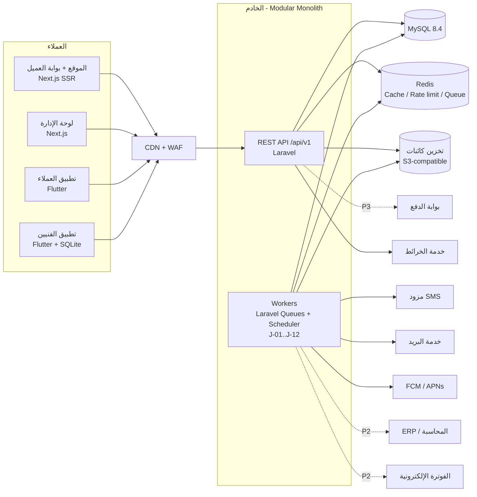
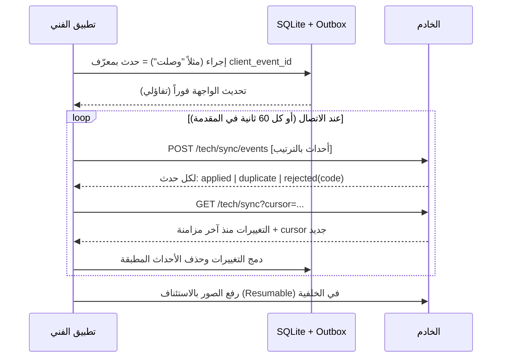
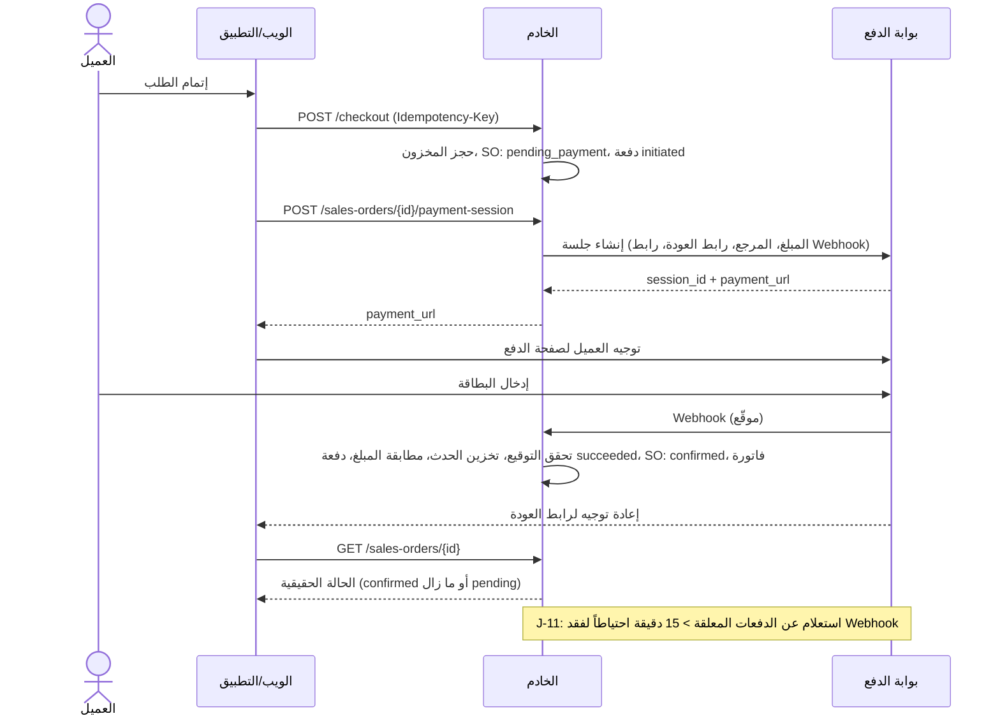

# 🏗️ المعمارية والقرارات التقنية
## منصة ضواحي البادية للمعدات الثقيلة

**الإصدار:** 1.0 (مسودة)
**التاريخ:** 2026-11-15
**المرجعية:** تحقق المتطلبات غير الوظيفية (NFR) في [01_srs.md](01_srs.md) §7، وتطبق نموذج البيانات في [03_data_model.md](03_data_model.md).

---

## 📌 جدول المحتويات

1. [نظرة عامة](#1-نظرة-عامة)
2. [سجل القرارات المعمارية (ADR)](#2-سجل-القرارات-المعمارية-adr)
3. [وحدات الخادم والأحداث](#3-وحدات-الخادم-والأحداث)
4. [عقد الـ API](#4-عقد-الـ-api)
5. [المصادقة والتفويض](#5-المصادقة-والتفويض)
6. [تطبيق الفني وتحمّل الانقطاع](#6-تطبيق-الفني-وتحمّل-الانقطاع)
7. [تدفق الدفع](#7-تدفق-الدفع)
8. [الإشعارات والملفات](#8-الإشعارات-والملفات)
9. [البنية التحتية والتشغيل](#9-البنية-التحتية-والتشغيل)
10. [الأمان](#10-الأمان)
11. [استراتيجية الاختبار](#11-استراتيجية-الاختبار)
12. [تكامل ERP (P2)](#12-تكامل-erp-p2)
13. [هيكل المستودع](#13-هيكل-المستودع)

---

## 1. نظرة عامة



**المبادئ:**
1. **وحدة نشر واحدة** (Modular Monolith) بحدود داخلية واضحة، والتقسيم لخدمات منفصلة فقط عند حاجة مثبتة.
2. **الخادم هو الحَكَم**: كل قواعد العمل وآلات الحالات تُنفَّذ في الخادم، والعملاء لا يقررون الحالات.
3. **عقد API أولاً**: ملف OpenAPI هو المرجع، ويُولَّد منه كود العملاء والتحقق (NFR-19).
4. **العمل الطويل خارج الطلب**: PDF، إشعارات، تكاملات، معالجة صور، كلها في طوابير Workers.

---

## 2. سجل القرارات المعمارية (ADR)

### ADR-01: Modular Monolith بدل الخدمات المصغّرة
- **الحالة:** مقترح
- **السياق:** فريق صغير، ونطاق متوسط، ومعاملات تمس عدة وحدات معاً (قبول عرض ← أمر عمل ← فاتورة).
- **القرار:** تطبيق خادم واحد مقسم لوحدات (القسم 3). كل وحدة تملك جداولها، والتواصل بين الوحدات عبر واجهات داخلية وأحداث مجال (Domain Events) داخل نفس العملية.
- **العواقب:** نشر واختبار ومعاملات أبسط. كل وحدة مجلد مستقل في `app/Modules/<Module>` داخل تطبيق Laravel، وتُفرض الحدود بـ Deptrac في CI لمنع الاعتماد المتبادل.

### ADR-02: التقنيات
- **الحالة:** معتمد (قرار العميل 2026-11-17)
- **القرار:** Laravel للخادم، و MySQL لقاعدة البيانات، و Flutter للتطبيقين. الويب يبقى Next.js.

| الطبقة | التقنية | التفاصيل |
|--------|---------|----------|
| الخادم | **Laravel 12+** على PHP 8.3+ | Eloquent، و Sanctum للمصادقة، و Policies للتفويض، و Form Requests للتحقق، و Events للأحداث |
| قاعدة البيانات | **MySQL 8.4 LTS** (InnoDB، `utf8mb4`) | البيانات المكانية بأنواع MySQL Spatial، والفروق عن PostgreSQL في 03 §1 |
| الطوابير والمهام المجدولة | Redis + Laravel Queues + **Horizon** | Laravel Scheduler للمهام J-01..J-12 (02 §9) |
| التطبيقات | **Flutter 3** (Dart) | Riverpod للحالة، و go_router للتنقل، و dio للشبكة، و drift (SQLite) لتطبيق الفني، و firebase_messaging للإشعارات، و mobile_scanner لملصقات QR |
| الويب (عام + بوابة + إدارة) | Next.js (TypeScript) | SSR للصفحات العامة (NFR-22)، ويستهلك نفس الـ API |
| البحث | MySQL `FULLTEXT` (محلل ngram) في P1 | Meilisearch عبر Laravel Scout عند الحاجة (ADR-09) |
| التخزين | S3-compatible + CDN | عبر Laravel Filesystem |
| ملفات PDF | Browsershot (Chromium) | قوالب Blade ثنائية اللغة بدعم كامل للعربية RTL (8.2) |

- **المبرر:** Laravel يوفر جاهزاً ما تحتاجه المنصة (المصادقة، والطوابير، والمهام المجدولة، والملفات، والإشعارات)، ومطوروه متوفرون في المنطقة. MySQL متاح لدى كل مزودي الاستضافة، ومنهم المحليون (ADR-07). Flutter يعطي واجهة واحدة متطابقة على Android و iOS، مع دعم جيد للعربية و RTL والكاميرا.
- **العواقب:**
  1. ثلاث لغات: PHP للخادم، و Dart للتطبيقين، و TypeScript للويب. لا كود مشترك بين الخادم والعملاء، فعقد OpenAPI هو الرابط الوحيد، ويُولَّد منه عميل Dart وعميل TypeScript (NFR-19).
  2. المال والضريبة والتقريب تُحسب في الخادم فقط بمكتبة `brick/math`، والعملاء يعرضون المبالغ كما تصل نصاً (4.1).
  3. MySQL لا يدعم الفهارس الجزئية ولا Row Level Security. البديلان موثقان في 03 §1 و §13.1.

### ADR-03: لا دردشة فورية في P1
- **الحالة:** معتمد
- **السياق:** المراسلات بين العميل والشركة مرتبطة بطلب وليست محادثة لحظية. والتحديث الدوري كل بضع ثوانٍ يُحمّل الخادم دون فائدة.
- **القرار:** محادثة لكل طلب (FR-MSG-01) تُجلب عند فتحها، والإشعار بالرسالة الجديدة عبر Push. البوابة تحدّث عداد الإشعارات كل 60 ثانية عندما تكون الصفحة ظاهرة فقط. والتواصل العاجل عبر واتساب (FR-MSG-02).
- **العواقب:** لا خوادم WebSocket. يمكن إضافة SSE لاحقاً دون تغيير نموذج البيانات.

### ADR-04: صفحة دفع مستضافة و Webhook كمصدر للحقيقة
- **الحالة:** معتمد للتنفيذ في **P3** (قرار الشركة 2026-11-15 بتأجيل الدفع الإلكتروني لآخر مرحلة). في P1 و P2 الدفعات يدوية فقط (FR-PAY-02، BR-18)، ونموذج البيانات يدعم البوابة من الآن (`payments.gateway_*`) فلا يلزم ترحيل لاحق كبير.
- **القرار:** إعادة توجيه العميل لصفحة البوابة (أو WebView في التطبيق). تأكيد الدفع **فقط** من Webhook موقّع، أو من استعلام الخادم المباشر للبوابة (J-11). صفحة العودة تعرض الحالة من الخادم ولا تعتمد على معاملات الرابط.
- **العواقب:** نطاق PCI بحده الأدنى SAQ-A (NFR-12). يجب معالجة الحالات الاستثنائية في 02 §10.

### ADR-05: تطبيق الفني يتحمّل انقطاع الشبكة (لا Offline-first كامل)
- **الحالة:** معتمد (عُدّل 2026-11-16: العمل في الورشة فقط، Q-08)
- **السياق:** الفنيون في ورشة واحدة بشبكة Wi-Fi، فلا حاجة للعمل أياماً دون اتصال. لكن الانقطاع القصير ممكن، والصور والاختبارات لا يجوز أن تضيع.
- **القرار:** صندوق صادر محلي (Outbox في SQLite عبر drift) لكل إجراء بمعرّف فريد يولّده الجهاز، ويُرسل فوراً إن وُجدت الشبكة أو عند عودتها. الخادم يطبق الأحداث بالترتيب ويرفض المكرر. لا تُحمَّل بيانات الأيام القادمة مسبقاً. التفاصيل في القسم 6.
- **العواقب:** تطبيق أبسط بكثير من نسخة العمل الميداني، مع بقاء ضمان عدم فقد البيانات (NFR-17).

### ADR-06: تطبيقان من قاعدة كود واحدة
- **الحالة:** معتمد
- **القرار:** تطبيق العملاء وتطبيق الفنيين مشروعا Flutter منفصلان في نفس المستودع، يتشاركان حزم Dart: عميل API، والترجمة، ورموز التصميم، ومكونات الواجهة.
- **المبرر:** جمهور وصلاحيات أجهزة مختلفة (الكاميرا ومسح ملصقات QR للفني)، وتوزيع مختلف (تطبيق الفني يمكن توزيعه داخلياً)، ودورات إصدار مستقلة.

### ADR-07: الاستضافة وإقامة البيانات
- **الحالة:** **القرار للشركة** (Q-12). هذا القسم يوضح الخيارات ومعايير المفاضلة لمساعدتها على القرار.
- **الخيارات:**
  1. منطقة سحابية خليجية لدى مزود عالمي (الإمارات، البحرين، قطر، السعودية).
  2. مزود سحابي أو مركز بيانات داخل السلطنة (مثل Oman Data Park).
- **معايير القرار:** شروط نقل البيانات الشخصية خارج السلطنة في قانون حماية البيانات ولائحته، وتوفر الخدمات المُدارة (MySQL، Redis، التخزين)، وزمن الاستجابة، والتكلفة، ومتطلبات العملاء الحكوميين.
- **الإجراء:** تختار الشركة المزود، ويُنصح بمراجعة قانونية قبل التعاقد. المعمارية لا تعتمد على خدمة حصرية لمزود معين (حاويات + MySQL + S3-compatible).

### ADR-08: مصدر الحقيقة مع ERP
- **الحالة:** **مفتوح** (Q-02)
- **القرار المؤقت:** في P1 المنصة هي مصدر الحقيقة لكل شيء. في P2 تُضاف وحدة تكامل معزولة تطبق مصفوفة القسم 12.
- **القيد:** لا تستدعي أي وحدة مجال الـ ERP مباشرة، بل عبر واجهة `ErpGateway` التي لها تنفيذ "بلا عمل" في P1.

### ADR-09: البحث
- **الحالة:** معتمد
- **القرار:** للقطع (FR-PRT-01): فهرس B-tree على الرقم المُطبّع للمطابقة التامة والبادئة، و `FULLTEXT` بمحلل ngram على الرقم المُطبّع والأسماء للبحث بجزء من الرقم أو الاسم. وللمعدات فلاتر SQL. يُضاف Meilisearch عبر Laravel Scout إن زادت القطع عن 300 ألف أو ضعفت جودة البحث العربي.

---

## 3. وحدات الخادم والأحداث

| الوحدة | تملك الجداول | المتطلبات |
|--------|-------------|-----------|
| `identity` | users, staff_profiles, user_roles, otp_challenges, sessions, devices, device_activation_codes, consents | AUTH، ADM-01 |
| `accounts` | organizations, organization_members, organization_invitations, addresses, customer_equipment, hour_meter_readings | ACC |
| `catalog` | brands, equipment_categories, equipment_models, equipment_listings, listing_media | CAT |
| `parts` | parts, part_cross_references, part_compatibility, part_media, stock_* | PRT |
| `quoting` | rfqs, rfq_items, rfq_attachments, quotations, quotation_items | RFQ |
| `ordering` | carts, cart_items, sales_orders, sales_order_items, return_requests, return_request_items, return_request_attachments | ORD |
| `service` | service_requests, service_request_attachments, workshop_intakes, workshop_intake_photos, service_handovers, test_templates, work_orders, work_order_*, time_entries, service_reports, additional_work_requests, additional_work_request_attachments, reviews، و P2: maintenance_contracts, contract_equipment, checklist_templates | SRV، WO، TEC |
| `billing` | invoices, invoice_items, credit_notes, payments, refunds, payment_webhook_events, number_sequences | PAY |
| `messaging` | conversations, messages, message_attachments, conversation_reads | MSG |
| `notifications` | notifications, notification_deliveries, notification_preferences | NOT |
| `content` | pages, faqs, banners, leads | CMS |
| `platform` | attachments, settings, audit_logs | ADM-03، ADM-04 |
| `reporting` | (قراءة فقط عبر Views) | RPT |
| `integrations` | جداول المزامنة (P2) | INT |

### أحداث المجال الرئيسية
| الحدث | يصدره | يستمع له |
|-------|-------|----------|
| `QuotationSent` | quoting | notifications (N-02، N-10)، service (SM-4 4.5/4.7، أو العمل الإضافي 4a.2) |
| `QuotationAccepted` (من العميل 2.3، أو آلياً 2.9) | quoting | service (4.8 أو 4a.4، والآلي 4.14 أو 4a.6)، catalog (حجز المعدة BR-19)، billing، ordering (3.14)، notifications (N-03 أو N-24) |
| `QuotationRejected` / `QuotationExpired` | quoting | service (4.9 للتقدير الأساسي، أو 4a.5 للإضافي)، notifications |
| `PaymentSucceeded` | billing | ordering (3.3)، notifications |
| `SalesOrderStatusChanged` | ordering | notifications (N-06)، parts (المخزون) |
| `ServiceRequestSubmitted` | service | notifications (N-08)، platform (SLA) |
| `WorkOrderStatusChanged` | service | notifications (N-11، N-13، N-28)، service (4.12، ثم N-12 جاهز للاستلام) |
| `WorkshopIntakeRecorded` / `ServiceHandedOver` | service | notifications (N-32 إيصال الاستلام)، billing (الدفعة عند التسليم BR-20) |
| `WorkOrderVerified` | service | billing (فاتورة)، service (تقرير PDF) |
| `InvoiceIssued` | billing | notifications (N-16)، integrations (P2) |
| `MessagePosted` | messaging | notifications (N-17) |

الأحداث تُحفظ في جدول Outbox داخل نفس المعاملة ثم تُعالج بالـ Workers (نمط Transactional Outbox) لضمان عدم ضياع إشعار أو أثر. في Laravel: الحدث كلاس Event، والمستمعون داخل نفس الوحدة متزامنون، والمستمعون في وحدات أخرى Queued Listeners تُرسل بعد الالتزام (`afterCommit`).

---

## 4. عقد الـ API

### 4.1 الاصطلاحات
| البند | القاعدة |
|-------|---------|
| المسار الأساسي | `/api/v1`. التغيير الكاسر يتطلب `/api/v2` مع دعم الإصدار السابق 6 أشهر على الأقل (التطبيقات القديمة) |
| الصيغة | JSON، أسماء الحقول `snake_case` |
| اللغة | ترويسة `Accept-Language: ar` أو `en`، والنصوص المترجمة تعود باللغة المطلوبة |
| المال | نص عشري + عملة: `{"amount": "1250.500", "currency": "OMR"}`. لا أرقام عائمة |
| الوقت | ISO-8601 بـ UTC: `2026-11-15T06:30:00Z`، والتواريخ `YYYY-MM-DD` |
| الترقيم | Cursor: `?limit=20&cursor=...` ← `{"data": [...], "next_cursor": "..."}` |
| التكرار الآمن | ترويسة `Idempotency-Key` إلزامية في: إنشاء الطلبات، والدفع، وقبول العروض، وأحداث المزامنة. التكرار بنفس المفتاح يعيد نفس النتيجة |
| التزامن | `If-Match: <version>` عند تعديل عرض أو أمر عمل ← `409 VERSION_CONFLICT` عند التعارض |
| الإصدار الأدنى للتطبيق | ترويسة `X-App-Version`، والخادم يرد `426 UPGRADE_REQUIRED` إن كان أقدم من الحد الأدنى |
| التتبع | كل استجابة تحمل `X-Trace-Id` |

### 4.2 صيغة الخطأ
```json
{
  "error": {
    "code": "INVALID_TRANSITION",
    "message": "لا يمكن قبول عرض منتهي الصلاحية",
    "details": { "from": "expired", "to": "accepted", "rule": "BR-02" },
    "trace_id": "4f2c..."
  }
}
```
**رموز ثابتة:** `VALIDATION_FAILED` (422)، `UNAUTHENTICATED` (401)، `FORBIDDEN` (403)، `NOT_FOUND` (404)، `INVALID_TRANSITION` (409)، `VERSION_CONFLICT` (409)، `RATE_LIMITED` (429)، `UPGRADE_REQUIRED` (426)، `PAYMENT_GATEWAY_ERROR` (502). الرسائل مترجمة، والعميل يعتمد على `code` لا على `message`.

### 4.3 فهرس نقاط النهاية الرئيسية
| الطريقة والمسار | الغرض | المتطلب |
|-----------------|-------|---------|
| `POST /auth/otp/request` ، `POST /auth/otp/verify` | طلب OTP والتحقق | FR-AUTH-01، 02، 05 |
| `POST /auth/token/refresh` ، `POST /auth/logout` | تدوير الجلسة والخروج | FR-AUTH-04 |
| `POST /auth/staff/login` ، `POST /auth/staff/2fa` | دخول الموظفين | FR-AUTH-03 |
| `GET/PATCH /me` ، `GET /me/sessions` ، `DELETE /me/sessions/{id}` | الملف والجلسات | FR-ACC-01، FR-AUTH-04 |
| `POST /me/data-export` ، `POST /me/deletion` | حقوق البيانات | FR-ACC-06 |
| `POST /organizations` ، `POST /organizations/{id}/invitations` | الشركة والأعضاء | FR-ACC-02 |
| `GET/POST /addresses` | العناوين | FR-ACC-04 |
| `GET/POST /fleet` ، `POST /fleet/{id}/hour-readings` ، `GET /fleet/{id}/history` | الأسطول | FR-ACC-05 |
| `GET /equipment` ، `GET /equipment/{slug}` ، `GET /equipment/facets` | الكتالوج | FR-CAT-01..03 |
| `GET /parts/search?q=` ، `GET /parts?model_id=` ، `GET /parts/{id}` | القطع | FR-PRT-01..03 |
| `POST /rfqs` ، `GET /rfqs` ، `GET /rfqs/{id}` ، `POST /rfqs/{id}/cancel` ، `POST /rfqs/{id}/reopen` | طلبات العروض، وتجديد العرض المنتهي (SM-1 انتقال 1.9) | FR-RFQ-01، FR-RFQ-04 |
| `POST /quotations/{id}/accept` ، `/reject` ، `/request-revision` | رد العميل | FR-RFQ-03 |
| `GET/PUT /cart` ، `POST /checkout` | السلة والطلب | FR-ORD-01، 02 |
| `POST /sales-orders/{id}/payment-session` | بدء الدفع الإلكتروني (P3) | FR-PAY-01 |
| `POST /admin/sales-orders/{id}/deliver` | التسليم مع تسجيل الدفعة في نفس المعاملة (BR-18) | FR-ORD-04، FR-PAY-02 |
| `GET /sales-orders` ، `POST /sales-orders/{id}/cancel` ، `POST /sales-orders/{id}/returns` | الطلبات والإرجاع | FR-ORD-03، 05 |
| `POST /service-requests` ، `GET /service-requests/{id}` ، `POST /service-requests/{id}/cancel` | الصيانة | FR-SRV-01، 04 |
| `POST /service-requests/{id}/review` | التقييم | FR-SRV-05 |
| `POST /admin/service-requests/{id}/intake` ، `POST /admin/service-requests/{id}/handover` ، `GET /admin/intakes/{number}` | استلام المعدة في الورشة وتسليمها مع تسجيل الدفعة في نفس المعاملة (BR-20) | FR-SRV-08، FR-SRV-09 |
| `GET /invoices` ، `GET /invoices/{id}/pdf` | الفواتير | FR-PAY-03 |
| `GET/POST /conversations/{id}/messages` | المراسلات | FR-MSG-01 |
| `GET /notifications` ، `POST /notifications/read` ، `PUT /notification-preferences` | الإشعارات | FR-NOT-01..03 |
| `POST /uploads` ← رابط رفع موقّع | رفع الملفات | NFR-11 |
| `GET /tech/tasks` ، `GET /tech/tasks/by-tag/{number}` ، `POST /tech/sync/events` | مهام الفني، وفتح المهمة بمسح الملصق، وإرسال الأحداث | FR-TEC-01..07 |
| `POST /webhooks/payments/{gateway}` | إشعار البوابة (P3) | FR-PAY-01 |
| `/admin/*` | كل عمليات لوحة الإدارة، بنفس الاصطلاحات، ومحمية بالأدوار | ADM، وغيرها |
| `GET /public/pages/{slug}` ، `/public/faqs` ، `/public/banners` ، `POST /public/leads` | المحتوى | CMS |

---

## 5. المصادقة والتفويض

| البند | العملاء (ويب وتطبيق) | الموظفون (لوحة الإدارة) | الفنيون (التطبيق) |
|-------|---------------------|------------------------|-------------------|
| طريقة الدخول | جوال + OTP، أو بريد + كلمة مرور | بريد + كلمة مرور + TOTP | بريد أو جوال + كلمة مرور + جهاز مسجل (العامل الثاني). الجهاز الجديد يُربط برمز تفعيل لمرة واحدة من A-11، والدخول من جهاز غير مربوط يُرفض |
| حمل الجلسة | الويب: كوكي `HttpOnly; Secure; SameSite=Lax` على خادم Next.js، وحماية CSRF في Server Actions. التطبيق: Access token في الذاكرة و Refresh في Keychain/Keystore | كوكي على خادم Next.js | Access + Refresh في Keychain/Keystore |
| مدة Access token | 15 دقيقة | 15 دقيقة | 15 دقيقة |
| مدة Refresh | التطبيق، أو الويب مع "تذكرني" (FR-AUTH-02): 60 يوماً. الويب دون "تذكرني": 24 ساعة. تدوير عند كل استخدام، وكشف إعادة الاستخدام يلغي كل الجلسات | 12 ساعة، وخمول 30 دقيقة (NFR-08) | 14 يوماً. العمل بدون اتصال لا يحتاج رمزاً صالحاً، والمزامنة تحتاجه |
| التفويض | قواعد الرؤية (03 §13.1) + صلاحية "اعتماد العروض" | RBAC حسب 01 §3.2 + قيد الفرع | أوامر العمل المسندة فقط |

**التفويض في الكود:** كل مسار يعلن صلاحيته (`->middleware('can:quotation.send')` أو Policy)، وخريطة الأدوار والصلاحيات في ملف واحد مُختبَر يطابق مصفوفة 01 §3.2.

**التنفيذ (قرار 2026-11-17):** آلية رموز واحدة لكل العملاء: رمز Sanctum قصير (15 دقيقة) يحمل `session_id`، و Refresh token يُخزَّن مجزّأً في `sessions` ويُدوَّر عند كل استخدام. استخدام رمز قديم بعد مهلة 30 ثانية يُعدّ سرقة فتُلغى كل جلسات المستخدم.
- **الويب (BFF):** المتصفح لا يرى أي رمز. خادم Next.js يحمل الرمزين في كوكيز `HttpOnly`، و `proxy.ts` يجدد رمز الوصول قبل عرض الصفحة. الطلبات المتزامنة (مثل جلب الروابط مسبقاً) تشارك تجديداً واحداً، وإلا اعتُبرت إعادة استخدام. مع أكثر من نسخة من خادم Next.js يُنقل هذا التنسيق إلى Redis. خادم Next.js يمرر عنوان المستخدم ومتصفحه للـ API، و Laravel يثق بهما من `TRUSTED_PROXIES` فقط. لا مصادقة بالكوكي في Laravel نفسه (Sanctum بلا Guard للجلسات).
- **التطبيقات:** الرموز في Keychain/Keystore عبر `flutter_secure_storage`.
- **الموظفون:** خطوتان: كلمة المرور ثم TOTP (يُلزم بإعداده عند أول دخول). الفني: كلمة المرور + جهاز مسجل برمز تفعيل لمرة واحدة.
- **كلمات المرور:** `argon2id`، وفي الإنتاج منع المسربة. أول مدير بالأمر `staff:create-admin`، ومخرج الطوارئ `staff:reset-2fa`.

---

## 6. تطبيق الفني وتحمّل الانقطاع

### 6.1 التخزين المحلي
- SQLite عبر drift، مشفر بـ SQLCipher بمفتاح في Keychain/Keystore (`flutter_secure_storage`)، للصندوق الصادر ونسخة مؤقتة من المهام المفتوحة فقط.
- البيانات المحلية: أوامر العمل المسندة المفتوحة، وبيانات المعدة أو المكوّن وصور الاستلام، وقوالب الاختبار. لا تحميل مسبق لأيام قادمة، ولا مخزون مركبات.
- عند إلغاء الجهاز (SM-7) تُمسح البيانات عند أول اتصال.

### 6.2 بروتوكول المزامنة



### 6.3 أنواع الأحداث
`status_changed` (مع `to_status` و `reason`)، `photo_added`، `note_added`، `part_used`، `part_removed`، `hour_meter_recorded`، `test_recorded`، `additional_work_requested`، `report_submitted`.

كل حدث يحمل: `client_event_id`، `work_order_id`، `occurred_at` (وقت الجهاز)، `device_id`، `payload`.

### 6.4 قواعد التعارض

| الحالة | القاعدة |
|--------|---------|
| حدث مكرر (نفس `client_event_id`) | يُعاد `duplicate` دون أثر |
| انتقال حالة غير صالح لأن الحالة في الخادم تغيرت | `rejected: INVALID_TRANSITION`، والتطبيق يعرض للفني الحالة الحقيقية |
| أمر العمل أُعيد إسناده أو أُلغي | الانتقالات تُرفض، والصور والملاحظات **تُقبل** وتُرفق مع علامة "من فني سابق" + تنبيه للمنسق (02 §10) |
| الصور والملاحظات والقطع | إلحاقية بمعرّفات الجهاز ولا تتعارض. حذف القطعة حدث مستقل `part_removed` |
| انحراف ساعة الجهاز | إن كان `occurred_at` بعد وقت الاستلام بأكثر من 5 دقائق يُستخدم وقت الاستلام ويُعلّم الحدث. ترتيب الأحداث يُحفظ بتسلسل محلي لكل جهاز |
| أوقات العمل والتنقل | يحسبها الخادم من أحداث الحالات، ولا يرسلها الجهاز كأرقام |
| التقرير النهائي | آخر إرسال من الفني الرئيسي يسري حتى `work_completed`. بعدها تعديلات المنسق فقط |
| تعديل الجدولة من المنسق | يصل للفني في المزامنة التالية + Push. لا تعديل جدولة بعد `in_progress` (SM-5) |

### 6.5 الوسائط
- ضغط الصور على الجهاز (الضلع الأطول 1920px، جودة 80%) مع الاحتفاظ بختم الوقت في البيانات الوصفية الداخلية.
- رفع بالاستئناف (Multipart أو بروتوكول tus) بروابط موقعة، وأولوية للأصغر حجماً، والرفع بالـ Wi-Fi فقط إعداد اختياري للفيديو.
- لا يُعتبر الحدث `report_submitted` مكتملاً في الخادم حتى ترتفع كل صور "بعد" المشار إليها، وتعرضه شاشة المزامنة (T-11).

---

## 7. تدفق الدفع

**P1 و P2 (الدفع عند الاستلام أو التسليم):** موظف القطع في الفرع أو المكلّف بالتوصيل يفتح الطلب ← يدخل رمز الاستلام (للفرع) أو إثبات التسليم ← يسجل الدفعة (نقد، بطاقة عبر نقاط البيع، تحويل) ← الخادم ينفذ في **معاملة واحدة**: إنشاء الدفعة `succeeded` + الانتقال إلى `delivered` + خصم المخزون + إصدار الفاتورة (BR-18). فشل أي جزء يلغي الكل.

**P3 (الدفع الإلكتروني):** المخطط التالي.



---

## 8. الإشعارات والملفات

### 8.1 خط الإشعارات
حدث مجال ← قاعدة الإشعار (01 §8) ← إنشاء `notifications` بلغة المستلم ← لكل قناة مفعّلة سجل `notification_deliveries` في طابور ← مرسل القناة مع إعادة المحاولة (3 مرات بتباعد أسي) ← تحديث الحالة. ساعات الهدوء لـ SMS تُطبق في الطابور (تأجيل).

### 8.2 الملفات
- الرفع مباشرة من العميل إلى التخزين بروابط موقعة (الخادم لا يمرر الملفات)، ثم تأكيد الرفع ← فحص برمجيات خبيثة في الطابور ← `scan_status = clean` شرط لاستخدام الملف.
- الملفات العامة (صور الكتالوج) عبر CDN بأحجام متعددة مولّدة. الخاصة (صور العملاء، الفواتير، التوقيعات) بروابط موقعة صالحة 15 دقيقة.
- ملفات PDF (عروض، فواتير، تقارير خدمة) تُولَّد في Worker من قوالب Blade ثنائية اللغة عبر Browsershot (Chromium، لدعم العربية RTL)، وتُحفظ ولا يُعاد توليدها (المستند الصادر ثابت).

---

## 9. البنية التحتية والتشغيل

| البند | القرار |
|-------|--------|
| التشغيل | حاويات (Docker) على خدمة حاويات مُدارة: API (Nginx + PHP-FPM) بنسختين على الأقل، و Workers (Horizon) بنسخة على الأقل، و Scheduler بنسخة واحدة فقط، مع توسع أفقي |
| قاعدة البيانات | MySQL 8.4 مُدار مع نسخة احتياطية مستمرة (binlog) واسترجاع لنقطة زمنية (NFR-05)، ونسخة قراءة (Replica) للتقارير عند الحاجة |
| البيئات | `dev` (محلي بـ Docker Compose)، `staging` (بوابة دفع وضع الاختبار، بيانات وهمية)، `production` |
| CI لكل تعديل | فحص الكود (Pint، `dart analyze`، ESLint)، والتحليل الثابت (PHPStan/Larastan)، وحدود الوحدات (Deptrac)، اختبارات الوحدة والتكامل، التحقق من توافق OpenAPI، فحص الترحيل (Migration)، فحص الثغرات في الاعتماديات، بناء الحاويات |
| CD | نشر آلي لـ staging، ونشر production بموافقة، والترحيلات متوافقة للخلف (توسيع ثم تقليص) |
| التطبيقات | بناء وتوقيع عبر Codemagic أو fastlane، وتطبيق العملاء عبر App Store و Google Play، وتطبيق الفني عبر توزيع داخلي (Managed Google Play / Apple Business Manager) أو متجر عام مع دخول للموظفين فقط. التحديثات عبر المتاجر (و Shorebird اختيارياً للإصلاحات العاجلة)، والحد الأدنى للإصدار مفروض (4.1) |
| المراقبة (NFR-20) | OpenTelemetry للتتبع، و Sentry للأخطاء (ويب + تطبيقات + خادم)، ومراقبة توفر خارجية، وسجلات منظمة بمعرّف التتبع |
| تنبيهات الأعمال | فشل Webhooks، تراكم الطوابير، أخطاء المزامنة، تجاوز SLA، فشل SMS، فروقات المطابقة |
| النسخ والاسترجاع | يومي مشفر محفوظ 30 يوماً + PITR، واختبار استرجاع ربع سنوي (NFR-05) |

---

## 10. الأمان

| المجال | الإجراء | المرجع |
|--------|---------|--------|
| المعيار | OWASP ASVS المستوى 2، واختبار اختراق قبل الإطلاق وسنوياً | NFR-06 |
| النقل والتخزين | TLS 1.2+ مع HSTS، وتشفير قاعدة البيانات والتخزين والنسخ | NFR-07 |
| كلمات المرور | Argon2id، وحد أدنى 10 أحرف للموظفين، ومنع كلمات المرور المسربة | – |
| OTP | تخزين الرمز مجزّأً (Hash)، وحدود المحاولات والإرسال (FR-AUTH-05)، وحماية من استنزاف رصيد SMS (حد لكل IP وكل دولة) | NFR-09 |
| الأسرار | مدير أسرار، ولا أسرار في الكود أو متغيرات CI المكشوفة، وتدوير دوري | NFR-07 |
| قاعدة البيانات | مستخدم للتطبيق بصلاحيات محدودة لكل جدول، ومنع التعديل والحذف على جداول التدقيق والدفاتر، واختبارات الرؤية الآلية كخط ثانٍ (MySQL بلا RLS) | 03 §13 |
| الويب | CSP صارم، و CSRF، وتنقية HTML في المحتوى المُدار، وحماية من الروبوتات على النماذج العامة | NFR-09 |
| الملفات | قائمة أنواع مسموحة، وفحص المحتوى الحقيقي، وفحص البرمجيات الخبيثة، وإزالة EXIF من الصور العامة | NFR-11 |
| الأجهزة | ربط جهاز الفني، والإلغاء عن بُعد، وتشفير SQLite، وكشف الأجهزة المكسورة الحماية (تحذير) | ADR-05 |
| التدقيق | كل العمليات في FR-ADM-04 تُسجل مع القيم قبل وبعد | NFR-10 |
| الخصوصية | تقليل البيانات، وسياسة احتفاظ لكل نوع، وإجراءات طلبات أصحاب البيانات، وخطة الإبلاغ عن الاختراق | NFR-13 |

---

## 11. استراتيجية الاختبار

| المستوى | الأداة المقترحة | ما يُختبر |
|---------|----------------|-----------|
| وحدة | Pest (الخادم)، و `flutter_test` (التطبيقات)، و Vitest (الويب) | المال والضريبة والتقريب (BR-01)، والصلاحيات، وقواعد العمل |
| آلات الحالات | اختبارات مولّدة من جداول 02 | **كل صف في جداول الانتقال** + التأكد أن كل انتقال غير مذكور مرفوض |
| تكامل | Pest مع MySQL 8.4 حقيقي في حاوية (لا SQLite) | الاستعلامات، والقيود، وقواعد الرؤية، والمعاملات |
| العقد | Spectator أو openapi-psr7-validator | توافق الاستجابات مع العقد، وعدم وجود تغيير كاسر |
| المزامنة | سيناريوهات مخصصة | التكرار، والترتيب، وإعادة الإسناد، وانحراف الساعة، وانقطاع الرفع |
| طرف لطرف (ويب) | Playwright | الرحلات في 02 §1 بالعربية والإنجليزية |
| طرف لطرف (تطبيق) | Maestro أو Patrol | تسجيل الدخول، وطلب الصيانة، ودورة مهمة الفني مع قطع الشبكة وعودتها |
| الوصول | axe + فحص يدوي | NFR-15 |
| الحمل | k6 | NFR-02، NFR-03 بضعف الأرقام |
| الأمان | فحص آلي (DAST) + اختبار اختراق | NFR-06 |
| قبول المستخدم (UAT) | سيناريوهات من شروط القبول في 05 | مع موظفي الشركة وعينة عملاء وفنيين |

---

## 12. تكامل ERP (P2)

مصفوفة مصدر الحقيقة المقترحة (تُعتمد بعد Q-02):

| البيانات | المصدر | الاتجاه | التوقيت |
|----------|--------|---------|---------|
| القطع والأسعار | ERP | ERP ← المنصة | كل 15 دقيقة + عند الطلب |
| المخزون | ERP | ERP ← المنصة | كل 5 دقائق، والحجز يُرسل فوراً |
| العملاء والشركات | المنصة للحسابات الرقمية، و ERP للحسابات المالية | ثنائي بربط `erp_ref` | عند التغيير |
| طلبات القطع المؤكدة | المنصة | المنصة ← ERP | فوراً (حدث) |
| الفواتير | **قرار مطلوب**: إما المنصة تصدر و ERP يستورد، أو ERP يصدر والمنصة تعرض | – | – |
| المدفوعات | المنصة (يدوية في P2، ومن البوابة في P3) | المنصة ← ERP | فوراً |
| أوامر العمل والتكلفة | المنصة | المنصة ← ERP | عند الإغلاق |

**التصميم:** وحدة `integrations` بطابور مستقل، وسجل مزامنة لكل سجل (`pending`، `synced`، `failed`) مع إعادة المحاولة، وشاشة أخطاء المزامنة في لوحة الإدارة. فشل ERP لا يوقف عمل المنصة.

---

## 13. هيكل المستودع

مستودع واحد مقسم حسب الطبقة (قرار 2026-11-17):

```
/
├── backend/                 # Laravel: الوحدات في القسم 3 تحت app/Modules، والاختبارات لكل وحدة في tests/Feature
├── frontend/                # Next.js: الموقع العام + بوابة العميل + لوحة الإدارة (src/app/[lang]/(site) و (admin))
├── mobile/
│   ├── customer_app/        # Flutter: core/ (الـ API والنصوص) و features/ (لكل ميزة مجلد)
│   ├── technician_app/      # Flutter + drift (SQLite)
│   └── packages/
│       ├── dwahi_ui/        # نظام التصميم المشترك: الرموز والسمة والشعار (01 §9)
│       └── api_client_dart/ # (قادم) مولّد من العقد للتطبيقين
├── contracts/
│   └── openapi/             # العقد المولّد من كود backend (Scramble)، ومنه أنواع frontend
├── infra/                   # Docker للتطوير، ولاحقاً البنية التحتية ككود
├── docs/                    # هذه الوثائق، والشعار، وأداة فحص الاتساق
└── .github/workflows/       # CI: وظيفة لكل طبقة
```

الترجمة ورموز التصميم من مصدر واحد للويب والتطبيقين (i18n و design_tokens) تُضاف حين يكتمل نظام التصميم (Q-01).
