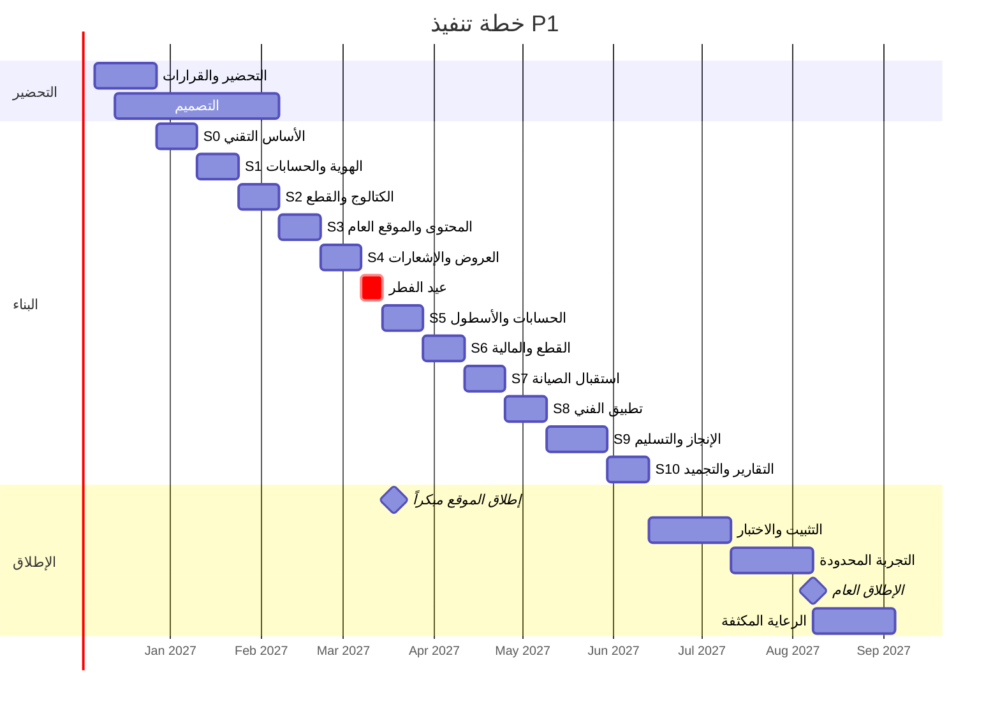

# 🗺️ خطة التنفيذ
## منصة ضواحي البادية للمعدات الثقيلة | من التحضير حتى الإطلاق وما بعده

**الإصدار:** 1.0 (مسودة للمراجعة)
**التاريخ:** 2026-11-17
**المرجعية:** النطاق والأولويات من [01_srs.md](01_srs.md)، والتقنيات من [04_architecture.md](04_architecture.md) (ADR-02)، والقصص من [05_user_stories.md](05_user_stories.md). هذه الخطة لا تعرّف متطلبات، بل ترتّب تنفيذها.

---

## 📌 جدول المحتويات

1. [الملخص](#1-الملخص)
2. [الافتراضات](#2-الافتراضات)
3. [الفريق](#3-الفريق)
4. [المراحل والجدول الزمني](#4-المراحل-والجدول-الزمني)
5. [المرحلة 0: التحضير والقرارات](#5-المرحلة-0-التحضير-والقرارات)
6. [التصميم](#6-التصميم)
7. [البناء: السبرنتات](#7-البناء-السبرنتات)
8. [القرارات المطلوبة ومواعيدها](#8-القرارات-المطلوبة-ومواعيدها)
9. [البيانات والمحتوى](#9-البيانات-والمحتوى)
10. [التثبيت والاختبار](#10-التثبيت-والاختبار)
11. [التجربة المحدودة والإطلاق](#11-التجربة-المحدودة-والإطلاق)
12. [التدريب](#12-التدريب)
13. [طريقة العمل والجودة](#13-طريقة-العمل-والجودة)
14. [مخاطر التنفيذ](#14-مخاطر-التنفيذ)
15. [ما بعد الإطلاق: P2 و P3](#15-ما-بعد-الإطلاق-p2-و-p3)
16. [بنود التكلفة](#16-بنود-التكلفة)
17. [الأسبوع الأول](#17-الأسبوع-الأول)

---

## 1. الملخص

| البند | القيمة |
|-------|--------|
| نطاق الإطلاق الأول (P1) | 71 متطلباً وظيفياً (59 Must + 12 Should)، و 47 قصة مستخدم، و 89 شاشة (15 موقع عام، 19 بوابة عميل، 21 لوحة إدارة، 23 تطبيق عملاء، 11 تطبيق فني) |
| المدة حتى الإطلاق العام | **حوالي 36 أسبوعاً (8 أشهر ونصف)** من بدء التحضير، بهامش تقدير ±20% |
| إطلاق مبكر | **الموقع العام والكتالوج** في الأسبوع 15 تقريباً، ليبدأ ظهوره في محركات البحث ويستقبل الاستفسارات بينما يكتمل الباقي |
| الفريق | 8 إلى 9 أشخاص (القسم 3) |
| طريقة العمل | سبرنتات أسبوعين (الأحد إلى الخميس)، وعرض لنتيجة كل سبرنت على ممثل الشركة |
| ترتيب البناء | شرائح عمودية: كل سبرنت ينهي ميزة كاملة من قاعدة البيانات حتى الشاشة، بترتيب الاعتماديات (الحسابات ← الكتالوج ← العروض ← القطع ← الصيانة ← تطبيق الفني) |

**أهم ثلاثة أمور تحدد نجاح الخطة:**
1. **قرارات الشركة في وقتها** (القسم 8). كل قرار يتأخر يوقف سبرنتاً بعينه.
2. **بيانات الكتالوج والقطع** نظيفة وفي موعدها (القسم 9)، وهي أعلى خطر في 01 §10.2.
3. **تبنّي الفنيين لتطبيق الفني**، ولذلك يُجرَّب مع فنيين حقيقيين قبل الإطلاق بوقت كافٍ.

---

## 2. الافتراضات

| # | الافتراض | إن لم يتحقق |
|---|----------|-------------|
| 1 | البدء يوم الأحد **2026-12-06** | كل التواريخ تُزاح بنفس الفرق |
| 2 | الفريق في القسم 3 متاح بدوام كامل من الأسبوع 4 | تطول المدة (انظر سيناريوهات القسم 3) |
| 3 | ممثل واحد من الشركة (مالك المنتج) يملك القرار ويحضر عرض كل سبرنت | تتأخر القرارات وتتراكم إعادة العمل |
| 4 | لوحة الإدارة بـ Next.js حسب ADR-02 | بديل Filament يقلل عمل الواجهات (القسم 8، قرار تقني) |
| 5 | رمضان 1448 تقريباً من 2027-02-08 إلى 2027-03-09 بساعات عمل أقل، وعيد الفطر تقريباً 2027-03-10، وعيد الأضحى تقريباً 2027-05-16 | تُعدَّل التواريخ حسب الإعلان الرسمي |
| 6 | الصيانة الميدانية خارج النطاق (01 §1.4) | – |

> **السعة في رمضان:** يُخطط لسبرنتَي رمضان (S3 و S4) بنحو 75% من السعة المعتادة، ولذلك حجمهما أصغر.

---

## 3. الفريق

### 3.1 التشكيل الموصى به

| الدور | العدد | المسؤولية | التفرغ |
|-------|------|-----------|--------|
| قائد تقني (Laravel، سنيور) | 1 | المعمارية، ومراجعة الكود، وعقد الـ API، والبنية التحتية و CI/CD، والأمان | كامل من الأسبوع 1 |
| مطور Laravel | 2 | وحدات الخادم، والمهام المجدولة، والتكاملات، وملفات PDF | كامل من الأسبوع 4 |
| مطور Flutter | 2 | تطبيق العملاء، وتطبيق الفني (أحدهما سنيور يملك تحمّل الانقطاع ADR-05) | كامل من الأسبوع 4 |
| مطور Next.js | 2 | الموقع العام وبوابة العميل ولوحة الإدارة (21 شاشة إدارية) | كامل من الأسبوع 4 |
| مصمم UX/UI | 1 | نظام التصميم ثم الشاشات، متقدماً على التطوير بسبرنتين | كامل الأسابيع 2 إلى 13، ثم جزئي |
| مهندس جودة (QA) | 1 | خطط الاختبار، واختبارات طرف لطرف، والانحدار، واختبارات القبول | كامل من الأسبوع 6 |
| مدير مشروع / محلل أعمال | 1 | الخطة، ومتابعة القرارات، والتواصل مع الشركة، وتحديث الوثائق | جزئي (50%) طوال المشروع |
| **من الشركة:** مالك المنتج | 1 | القرارات، وقبول نتيجة كل سبرنت، وتوفير البيانات | 4 إلى 6 ساعات أسبوعياً |

### 3.2 سيناريوهات حجم الفريق

| السيناريو | المدة التقريبية حتى الإطلاق | ملاحظة |
|-----------|-----------------------------|--------|
| الفريق الموصى به (القسم 3.1) | 8 أشهر ونصف | الخطة الحالية |
| لوحة الإدارة بـ Filament بدل Next.js | نفس المدة بمطور Next.js واحد، أو أقصر بشهر تقريباً بنفس الفريق | يتطلب قراراً قبل S0 (القسم 8) |
| فريق مصغّر (مطور Laravel + مطور Flutter + مطور Next.js + قائد تقني) | 12 إلى 14 شهراً | السبرنتات نفسها بسعة أقل، والخطر الأكبر غياب QA مستقل |

---

## 4. المراحل والجدول الزمني

| المرحلة | الأسابيع | التواريخ التقريبية | الناتج |
|---------|----------|--------------------|--------|
| 0. التحضير والقرارات | 1 – 3 | 2026-12-06 → 2026-12-24 | الحسابات والعقود والقرارات الحرجة (القسم 5) |
| التصميم | 2 – 9 | 2026-12-13 → 2027-02-04 | نظام التصميم وكل شاشات P1، متقدماً على التطوير |
| البناء S0 – S4 | 4 – 13 | 2026-12-27 → 2027-03-04 | الأساس، والحسابات، والكتالوج، والمحتوى، والعروض |
| عطلة عيد الفطر | 14 | 2027-03-07 → 2027-03-11 | هامش |
| 🚩 **إطلاق الموقع العام مبكراً** | 15 | 2027-03-14 → 2027-03-18 | الموقع العام والكتالوج والاستفسارات في الإنتاج |
| البناء S5 – S10 | 15 – 27 | 2027-03-14 → 2027-06-17 | الحسابات المتقدمة، والقطع والمالية، والصيانة، وتطبيق الفني، والتقارير. وتجميد الميزات في نهاية الأسبوع 27 |
| التثبيت والاختبار | 28 – 31 | 2027-06-20 → 2027-07-15 | اختبار الاختراق والحمل والقبول، ونشر التطبيقات في المتاجر |
| التجربة المحدودة | 32 – 35 | 2027-07-18 → 2027-08-12 | 10 عملاء وكل الفنيين لمدة 4 أسابيع (01 §4) |
| 🚀 **الإطلاق العام** | 36 | 2027-08-15 → 2027-08-19 | بعد قرار "جاهز للإطلاق" (القسم 11.3) |
| الرعاية المكثفة | 36 – 39 | 2027-08-15 → 2027-09-09 | دعم يومي وإصلاحات سريعة |
| بدء P2 | 40 | 2027-09-12 | القسم 15 |

> **S9 ثلاثة أسابيع** لأن عيد الأضحى يقع في منتصفه.

---

## 5. المرحلة 0: التحضير والقرارات

**الهدف:** ألا يتوقف أي سبرنت لاحقاً بسبب حساب أو عقد أو جهاز أو قرار. بعض هذه البنود يأخذ أسابيع، فتبدأ كلها في الأسبوع الأول.

### 5.1 بنود تحتاج وقتاً طويلاً (تبدأ فوراً)

| البند | لماذا مبكراً | مطلوب قبل |
|-------|--------------|-----------|
| رقم D-U-N-S للشركة | شرط لحساب المطوّر المؤسسي في Apple، ولتوثيق حساب الشركة في Google Play | الأسبوع 6 |
| حساب Apple Developer (مؤسسي) و Google Play Console (مؤسسي) | التوثيق يأخذ أياماً إلى أسابيع | S1 (للاختبار الداخلي) |
| توزيع تطبيق الفني داخلياً | Apple ترفض غالباً تطبيقات الموظفين في المتجر العام، فيُوزَّع عبر Apple Business Manager (Custom App) و Managed Google Play (04 §9) | S8 |
| اسم المرسل لرسائل SMS (Q-04) | التسجيل لدى المزود والجهة المنظمة يأخذ أسابيع، وهو شرط لرمز OTP | S1 |
| الاستضافة ومراجعتها القانونية (Q-12، ADR-07) | بيئة الإنتاج مطلوبة للإطلاق المبكر للموقع | الأسبوع 12 |
| النطاق (Domain) والبريد و DNS | الروابط والبريد والتحقق من الحسابات | S0 |
| مشروع Firebase (FCM) ومفتاح APNs | إشعارات Push | S4 |
| مفتاح خدمة الخرائط (FR-INT-03) | العناوين والفروع | S3 |
| حجز جهة اختبار الاختراق (NFR-06) | جداولها ممتلئة غالباً | الأسبوع 28 |

### 5.2 الأجهزة والتجهيزات في الورشة

| البند | الاستخدام | مطلوب قبل |
|-------|-----------|-----------|
| جهاز لوحي في الاستقبال | توقيع العميل عند الاستلام والتسليم (A-22، BR-20) | S7 |
| طابعة ملصقات QR وملصقات تتحمل الزيت والحرارة | ملصق بطاقة الاستلام على المعدة أو المكوّن (FR-SRV-08) | S7 |
| أجهزة الفنيين (20) إن كانت من الشركة، مع إدارة الأجهزة (MDM) | تطبيق الفني (01 §10.1) | S8 (5 أجهزة للتجربة)، والتجربة المحدودة (الكل) |
| مسح تغطية Wi-Fi في ساحة الورشة | تحمّل الانقطاع مصمم للانقطاع القصير لا لغياب الشبكة (ADR-05) | S8 |

### 5.3 ناتج المرحلة 0
- قائمة قرارات القسم 8 بمالك وتاريخ لكل قرار.
- قوالب Excel للكتالوج والقطع مسلّمة للشركة (القسم 9).
- الحسابات (Apple، Google، Firebase، الخرائط، SMS، الاستضافة) بأسماء الشركة لا بأسماء أفراد، ومدير الأسرار يحفظ مفاتيحها.

---

## 6. التصميم

يبدأ المصمم في الأسبوع 2، ويبقى متقدماً على التطوير بسبرنتين: شاشات السبرنت تُعتمد قبل بدايته.

| الفترة | الناتج |
|--------|--------|
| الأسابيع 2 – 3 | نظام التصميم من رموز 01 §9 وهوية "الضاد": الألوان، والخطوط، والمكونات الأساسية بالعربية والإنجليزية (RTL و LTR)، وألوان الحالات (01 §9.2) |
| الأسابيع 3 – 5 | شاشات S1 و S2: الدخول والتسجيل، والكتالوج، والقطع، ولوحة الإدارة الأساسية |
| الأسابيع 5 – 7 | شاشات S3 إلى S5 |
| الأسابيع 7 – 9 | شاشات الصيانة وتطبيق الفني (S7 إلى S9)، مع **اختبار نموذج تفاعلي لتطبيق الفني مع 3 فنيين في الورشة** (NFR-16) |
| الأسابيع 9 – 13 | باقي الشاشات، وحالات الخطأ والفراغ والتحميل (06 §5)، ثم دعم جزئي للتطوير |

**اعتماد الشعار (Q-01)** مطلوب قبل نهاية الأسبوع 3، لأن نظام التصميم مبني عليه.

---

## 7. البناء: السبرنتات

كل سبرنت ينتهي بنسخة على بيئة staging تُعرض على الشركة. الشاشات والقصص مرتبطة بمعرّفاتها في 05 و 06 و 07.

### S0: الأساس التقني (الأسبوعان 4 – 5)
لا ميزات للمستخدم، بل كل ما تقوم عليه الميزات:
- المستودع (04 §13)، و CI بكل بوابات الجودة (04 §9)، وبيئتا dev و staging، والنشر الآلي لـ staging.
- Laravel بالوحدات (04 §3) و Deptrac، و MySQL 8.4، و Redis و Horizon، وتتبع الأخطاء والسجلات (NFR-20).
- خط عقد الـ API: ملف OpenAPI، وتوليد عميل Dart وعميل TypeScript في CI (NFR-19).
- البنى المشتركة: رفع الملفات بروابط موقعة وفحصها (NFR-11، 04 §8.2)، والترقيم (BR-14)، وسجل التدقيق (FR-ADM-04)، والإعدادات (FR-ADM-03)، و**قواعد رؤية العميل والشركة (03 §13.1) من اليوم الأول**، لأن إضافتها لاحقاً تعني مراجعة كل الاستعلامات.
- هياكل التطبيقين و Next.js: التنقل، والترجمة من مصدر واحد (NFR-14)، والاتجاه RTL، ورموز التصميم.

### S1: الهوية والحسابات الأساسية (الأسبوعان 6 – 7)
| المتطلبات | FR-AUTH-01، FR-AUTH-02، FR-AUTH-03، FR-AUTH-05، FR-ACC-01، FR-ADM-01، FR-INT-02 |
|---|---|
| القصص | US-06، US-07، US-39، US-44 |
| الشاشات | W-14، W-15، W-16، W-17، C-01، C-02، M-01 إلى M-05، M-22، A-21، A-17، A-19 |
| الشرط | اسم مرسل SMS جاهز، أو مزود اختبار مؤقت على staging |

### S2: الكتالوج والقطع (الأسبوعان 8 – 9)
| المتطلبات | FR-CAT-01، FR-CAT-02، FR-CAT-03، FR-CAT-06، FR-CAT-07، FR-PRT-01، FR-PRT-02، FR-PRT-03، FR-PRT-04 |
|---|---|
| القصص | US-01، US-02 (العرض، وزر طلب السعر في S4)، US-03، US-04 (يكتمل مع الأسطول في S5)، US-36، US-37 |
| الشاشات | W-01، W-02، W-03، W-04، W-05، A-02، A-03، A-04، M-06، M-07، M-08، M-09، M-10 |
| إضافة | **أداة استيراد Excel** للقطع والمعدات تكشف الأرقام المكررة والبديلة الناقصة (01 §10.2) |
| الشرط | Q-05 و Q-06 و Q-19، والدفعة الأولى من بيانات الكتالوج |

### S3: المحتوى والموقع العام (الأسبوعان 10 – 11، رمضان)
| المتطلبات | FR-CMS-01، FR-CMS-03، FR-CMS-04، FR-CMS-05، FR-CMS-06، FR-ADM-02، FR-INT-03 |
|---|---|
| القصص | US-05، US-40، US-42، US-43 |
| الشاشات | W-06 إلى W-11، A-14، A-15، A-18 |
| الشرط | Q-10 (الماركات)، ونصوص "من نحن" والسياسات من الشركة |

### S4: العروض والمراسلة والإشعارات (الأسبوعان 12 – 13، رمضان)
| المتطلبات | FR-RFQ-01 إلى FR-RFQ-05، FR-PRT-05، FR-MSG-01، FR-MSG-02، FR-NOT-01، FR-NOT-02 |
|---|---|
| القصص | US-12، US-13، US-21، US-32، US-23 (القنوات، والتفضيلات في S5) |
| الشاشات | C-07، C-08، C-09، C-19، M-18، M-20، M-21، M-24، A-05، A-06 |
| إضافة | قوالب PDF للعروض (04 §8.2)، والمهمتان J-02 و J-03 |
| بالتوازي | **تجهيز الإطلاق المبكر** (جزء من الفريق): بيئة الإنتاج، وفحص أمني أساسي للموقع العام، وإدخال المحتوى، وخريطة الموقع و Search Console (NFR-22) |
| الشرط | Q-13 (أوامر الشراء LPO) |

### 🚩 الإطلاق المبكر للموقع العام (الأسبوع 15)
- **يُطلق:** الموقع العام (W-01 إلى W-11، W-17)، والكتالوج، ونموذج الاستفسار، ولوحة الإدارة لإدارة المحتوى والكتالوج والاستفسارات فقط.
- **لا يُطلق بعد:** التسجيل والبوابة والتطبيقات. أزرار "اطلب السعر" تفتح نموذج الاستفسار أو واتساب (FR-MSG-02) حتى S5.
- **الفائدة:** محركات البحث تحتاج أشهراً لفهرسة الكتالوج، والشركة تبدأ تجمع الطلبات وتتعود على لوحة الإدارة.

### S5: الحسابات المتقدمة والأسطول (الأسبوعان 15 – 16)
| المتطلبات | FR-ACC-02، FR-ACC-04، FR-ACC-05، FR-ACC-06، FR-AUTH-04، FR-NOT-03، FR-ADM-05 |
|---|---|
| القصص | US-08، US-09، US-10، US-11، US-45، واكتمال US-04 و US-23 |
| الشاشات | C-03، C-04، C-05، C-06، C-20، M-13، M-14، A-12 |
| إضافة | المهمة J-08 (تجهيل الحسابات المحذوفة، BR-16) |

### S6: طلبات القطع والمالية (الأسبوعان 17 – 18)
| المتطلبات | FR-ORD-01 إلى FR-ORD-05، FR-PAY-02، FR-PAY-03، FR-PAY-06 |
|---|---|
| القصص | US-14، US-15، US-16، US-22، US-35، US-38 |
| الشاشات | C-10، C-11، C-13، C-14، C-18، M-11، M-19، M-23، A-07، A-13 |
| إضافة | قالب الفاتورة الضريبية PDF، والمهمة J-01، ومراجعة المحاسب لحساب الضريبة والتقريب (BR-01) على أمثلة حقيقية |
| الشرط | **Q-17** (الاسم القانوني والسجل التجاري والرقم الضريبي على الفاتورة)، وتأكيد Q-02 بأن المنصة مصدر الحقيقة في P1، وقيم Q-07 |

### S7: استقبال الصيانة والتقدير والتوزيع (الأسبوعان 19 – 20)
| المتطلبات | FR-SRV-01، FR-SRV-02، FR-SRV-03، FR-SRV-08، FR-WO-01، FR-WO-02 |
|---|---|
| القصص | US-17، US-18، US-31، US-33، US-48 |
| الشاشات | C-15، C-16، M-15، M-16، A-08، A-09، A-10، A-22 (الاستلام) |
| إضافة | بطاقة الاستلام وملصق QR، والمهمة J-04 (SLA الفرز) |
| الشرط | **Q-20** (نسخة ورقة الشركة)، والجهاز اللوحي وطابعة الملصقات |

### S8: تطبيق الفني (الأسبوعان 21 – 22)
| المتطلبات | FR-TEC-01، FR-TEC-02، FR-TEC-03، FR-TEC-04، FR-TEC-07، FR-WO-03، FR-WO-04 |
|---|---|
| القصص | US-24، US-25، US-26، US-27، US-30 |
| الشاشات | T-01، T-02، T-03، T-04، T-06، T-07، T-11، T-12، A-11 |
| إضافة | بروتوكول المزامنة والصندوق الصادر (04 §6)، واختبار قطع الشبكة وإغلاق التطبيق ونفاد البطارية (NFR-17) |
| تجربة | **5 فنيين يستخدمون التطبيق على أوامر عمل حقيقية** على staging في آخر الأسبوع 22، وملاحظاتهم تدخل S9 |

### S9: الإنجاز والتسليم (الأسابيع 23 – 25، فيها عيد الأضحى)
| المتطلبات | FR-TEC-05، FR-TEC-06، FR-WO-05، FR-SRV-04، FR-SRV-05، FR-SRV-09 |
|---|---|
| القصص | US-19، US-20، US-28، US-29، US-34، US-49 |
| الشاشات | T-08، T-09، T-10، C-17، M-17، A-22 (التسليم) |
| إضافة | قوالب الاختبار من ورقة الشركة (Q-20)، وتقرير الخدمة وإيصال التسليم PDF، والمهمتان J-05 و J-12 |

### S10: التقارير والإكمال وتجميد الميزات (الأسبوعان 26 – 27)
| المتطلبات | FR-RPT-01، FR-RPT-03 |
|---|---|
| القصص | US-41 |
| الشاشات | A-01، A-16 |
| إضافة | المهمة J-10، ومراجعة الوصول (NFR-15) واللغتين (NFR-14)، وتحسين الأداء، وإغلاق ملاحظات تجربة الفنيين |
| نهاية السبرنت | **تجميد الميزات**: بعدها إصلاحات فقط حتى الإطلاق |

### 7.1 التحقق من التغطية

| | P1 في الوثائق | في السبرنتات |
|---|---|---|
| المتطلبات الوظيفية | 71 | 71 |
| القصص | 47 | 47 |
| الشاشات | 89 | 89 |

> أي تعديل على السبرنتات يُراجع بهذا الجدول، فلا تسقط ميزة دون قرار.

---

## 8. القرارات المطلوبة ومواعيدها

قرار متأخر يوقف السبرنت المذكور. الافتراض الحالي لكل سؤال في 00_README.md §5، ويُعمل به إن لم يصل القرار في موعده، مع تسجيل ذلك في سجل القرارات.

| القرار | يوقف | آخر موعد |
|--------|------|----------|
| **تقني:** لوحة الإدارة بـ Next.js أم Filament | حجم فريق الواجهات وتصميم الإدارة | نهاية الأسبوع 3 |
| **تقني:** عقد الـ API يُكتب يدوياً أولاً أم يُولَّد من الكود (Scramble) مع فحص التغيير الكاسر | S0 | نهاية الأسبوع 3 |
| Q-01 اعتماد الشعار | نظام التصميم | نهاية الأسبوع 3 |
| Q-12 الاستضافة | بيئة الإنتاج والإطلاق المبكر | نهاية الأسبوع 3 (مع وقت للمراجعة القانونية والتجهيز) |
| Q-15 شكل الأرقام | نظام التصميم والتوطين | نهاية الأسبوع 3 |
| Q-04 مزود SMS واسم المرسل | S1 | البدء في الأسبوع 1 |
| Q-05 عرض الأسعار مع الضريبة أو دونها، و Q-06 إظهار أسعار المعدات | S2 | الأسبوع 7 |
| Q-19 القطع الجاهزة المعروضة للبيع | S2 | الأسبوع 7 |
| Q-10 الماركات والوكالات | S3 | الأسبوع 9 |
| Q-13 أوامر الشراء LPO والدفع الآجل | S4 | الأسبوع 11 |
| Q-17 الاسم القانوني، والسجل التجاري، والرقم الضريبي | S6 (الفاتورة) | الأسبوع 16 |
| Q-02 نظام ERP أو المحاسبة الحالي | S6 (تأكيد أن المنصة مصدر الحقيقة في P1) وتخطيط P2 | الأسبوع 16 |
| Q-07 قيم سياسات الإلغاء والإرجاع والرسوم | S6 و S7، والقيم النهائية قبل التجربة المحدودة | الأسبوع 16 |
| Q-20 نسخة ورقة الشركة بعد الإصلاح | S7 (بطاقة الاستلام) و S9 (قوالب الاختبار) | الأسبوع 18 |
| Q-14 الفوترة الإلكترونية | P2 (تصميم الفاتورة قابل للتكيّف من الآن) | قبل تخطيط P2 |

---

## 9. البيانات والمحتوى

| البند | المسؤول | الموعد | ملاحظات |
|-------|---------|--------|---------|
| قوالب Excel للمعدات والقطع والأرقام البديلة والتوافق | الفريق | الأسبوع 2 | بأمثلة معبأة، والحقول الإلزامية من 03 §4 و §5 |
| الدفعة الأولى: 50 معدة و 500 قطعة الأكثر طلباً، بالصور | الشركة | الأسبوع 8 | لاختبار الاستيراد وعرض الكتالوج في S2 |
| تنظيف البيانات وإعادة الاستيراد | الفريق + الشركة | الأسابيع 8 – 13 | تقرير بالمكررات والناقص بعد كل استيراد |
| كامل الكتالوج المعروض للإطلاق المبكر | الشركة | الأسبوع 13 | ما لا يكتمل يُنشر لاحقاً من لوحة الإدارة |
| صور أصلية بجودة عالية (لا لقطات فيسبوك) | الشركة | الأسبوع 10 | من قائمة المحتوى في `company_content/00_قائمة_المحتوى.md` |
| نصوص "من نحن" والخدمات والسياسات والأسئلة الشائعة | الشركة (والفريق يحرر) | الأسبوع 10 | بالعربية والإنجليزية (NFR-14) |
| حسابات الموظفين وأدوارهم (01 §3) | الشركة | الأسبوع 26 | تُدخل من A-17 |
| بيانات العملاء الحاليين | الشركة | اختياري | استيراد إن توفرت بجودة كافية، وإلا يسجل العملاء بأنفسهم (01 §10.1) |
| المخزون الفعلي (جرد) | الشركة | قبل التجربة المحدودة بأسبوع | لتكون مستويات التوفر (BR-04) صحيحة يوم البدء |

---

## 10. التثبيت والاختبار (الأسابيع 28 – 31)

| البند | المعيار | المرجع |
|-------|---------|--------|
| اختبار انحدار كامل طرف لطرف | كل الرحلات في 02 §1 بالعربية والإنجليزية، على الويب والتطبيقين | 04 §11 |
| اختبار القبول مع موظفي الشركة | سيناريوهات من شروط القبول في 05، ويوقّع عليها مالك المنتج | 04 §11 |
| اختبار الحمل | ضعف أرقام NFR-03، وأزمنة NFR-02 | NFR-02، NFR-03 |
| اختبار الاختراق من جهة خارجية | لا ثغرات حرجة أو عالية مفتوحة | NFR-06 |
| اختبار الاسترجاع | استرجاع قاعدة البيانات لنقطة زمنية على بيئة منفصلة، بمحضر | NFR-05 |
| الوصول | فحص آلي ويدوي | NFR-15 |
| المراجعة اللغوية | كل النصوص بالعربية والإنجليزية، ولا نص ثابت في الكود | NFR-14 |
| مصفوفة الأجهزة والمتصفحات | Android 9+ و iOS 15+ وآخر إصدارين من المتصفحات | NFR-18 |
| نشر التطبيقات | تطبيق العملاء في المتجرين (مراجعة Apple قد تأخذ أياماً، وقد تُرفض أول مرة)، وتطبيق الفني بالتوزيع الداخلي | 04 §9 |
| المراقبة والتنبيهات | تعمل وتصل للمناوب | NFR-20 |

**هامش التقدير:** هذه الأسابيع الأربعة تحتوي أيضاً هامش المشروع. إن تأخر البناء أسبوعاً يُؤخذ من هنا، وأي تأخير أكبر يرفع للقرار: تأجيل الإطلاق أم نقل متطلب Should إلى ما بعد الإطلاق.

---

## 11. التجربة المحدودة والإطلاق

### 11.1 التجربة المحدودة (الأسابيع 32 – 35)
- **المشاركون:** 10 عملاء مختارون (أفراد وشركات)، وكل الفنيين العشرين، وكل الموظفين (01 §4).
- **التشغيل:** عمليات حقيقية على الإنتاج. تسجيل الدفعات يدوي كما في P1 (BR-18).
- **المتابعة:** اجتماع يومي 15 دقيقة لفرز المشاكل، وقناة دعم واحدة للموظفين والفنيين.
- **معيار النجاح:** 4 أسابيع دون أعطال حرجة (01 §4).

### 11.2 الإطلاق العام (الأسبوع 36)
- فتح التسجيل للجميع، ونشر تطبيق العملاء في المتجرين.
- التسويق: منشورات فيسبوك و Reels، ورسالة واتساب للعملاء الحاليين، و**ملصق QR في استقبال الورشة** لتحميل التطبيق.

### 11.3 قرار "جاهز للإطلاق"

| المعيار | الحالة المطلوبة |
|---------|-----------------|
| الأعطال | لا أعطال حرجة أو عالية مفتوحة |
| التجربة المحدودة | 4 أسابيع دون عطل حرج |
| الأمان | ثغرات الاختراق الحرجة والعالية مغلقة |
| الأداء | اختبار الحمل ناجح |
| النسخ والاسترجاع | اختبار الاسترجاع ناجح بمحضر |
| التطبيقات | معتمدة في المتجرين والتوزيع الداخلي |
| التدريب | كل الموظفين والفنيين متدربون (القسم 12) |
| الدعم | مناوبة ومسار تصعيد واضحان لفترة الرعاية المكثفة |
| البيانات | الكتالوج والمخزون والإعدادات (Q-07) نهائية |

### 11.4 الرعاية المكثفة (الأسابيع 36 – 39)
- الفريق كاملاً متاح، ومراجعة يومية للأخطاء والمراقبة.
- إصلاحات تُنشر بسرعة، وقياس أول لمؤشرات 01 §1.2.
- في نهايتها: تسليم التشغيل لفريق دعم أصغر، وبدء P2.

---

## 12. التدريب

| الفئة | الشكل | المحتوى | الموعد |
|-------|-------|---------|--------|
| مالك المنتج والمدير | جلسات مع كل عرض سبرنت | استخدام لوحة الإدارة أولاً بأول | من S1 |
| المبيعات، والمنسق، والقطع، والمحاسب، والمحتوى | جلسة لكل دور (ساعتان) + دليل مختصر | الشاشات الخاصة بالدور (06 §3) | الأسبوع 30 |
| الفنيون | جلسات عملية في الورشة بمجموعات صغيرة (30 دقيقة) + بطاقة مطبوعة | تطبيق الفني: المهام، والصور، والقطع، والاختبار، والعمل دون شبكة | الأسبوع 31 |
| العملاء | فيديو قصير بالعربية + مساعدة في الاستقبال | التسجيل، وطلب الصيانة، والقطع | الإطلاق العام |

> المحرر في لوحة الإدارة يُدرَّب قبل الإطلاق المبكر (الأسبوع 14) لأنه يبدأ العمل حينها.

---

## 13. طريقة العمل والجودة

### 13.1 الإيقاع
| الاجتماع | التكرار | الحضور |
|----------|---------|--------|
| التخطيط | بداية كل سبرنت | الفريق + مالك المنتج |
| متابعة يومية | يومياً 15 دقيقة | الفريق |
| عرض النتيجة | نهاية كل سبرنت | الفريق + مالك المنتج + من يلزم من الشركة |
| القرارات | أسبوعياً 30 دقيقة | مدير المشروع + مالك المنتج، على قائمة القسم 8 |
| المراجعة الداخلية | نهاية كل سبرنت | الفريق |

### 13.2 جاهزية القصة للبدء (Definition of Ready)
- شروط القبول مكتوبة في 05.
- تصميم الشاشات معتمد.
- القرارات التي تعتمد عليها محسومة، أو مسجل افتراضها.

### 13.3 اكتمال القصة (Definition of Done)
- كل شروط القبول تتحقق، ويتحقق منها QA على staging.
- مراجعة كود من مطور آخر، و CI أخضر (04 §9).
- اختبارات الوحدة والتكامل، والتغطية ≥ 70% لوحدات المجال (NFR-19)، واختبار لكل انتقال حالة جديد (04 §11).
- عقد الـ API محدث، والعميلان المولّدان يبنيان دون خطأ.
- النصوص في ملفات الترجمة باللغتين، والواجهة سليمة بالاتجاهين (NFR-14).
- العمليات الحساسة مسجلة في التدقيق (FR-ADM-04).
- إن تغيرت المتطلبات أو القصص أو الشاشات: الوثائق محدثة و `python tools/trace_check.py docs --write` دون مشاكل.

### 13.4 إدارة التغيير
- أي طلب جديد من الشركة يُقيَّم: هل هو P1 أم يُؤجل؟ وما الذي يخرج مقابله إن دخل P1؟
- القرار يُسجل في سجل القرارات (00_README.md §6) ويُحدَّث 01 أولاً ثم الباقي.
- بعد S2 يُعاد التقدير بسرعة الفريق الفعلية، وتُحدَّث هذه الخطة.

---

## 14. مخاطر التنفيذ

مخاطر المنتج في 01 §10.2. هنا مخاطر التنفيذ فقط:

| الخطر | الاحتمال | الأثر | التخفيف |
|-------|----------|-------|---------|
| تأخر قرارات الشركة | عالٍ | عالٍ | مواعيد القسم 8، واجتماع قرارات أسبوعي، والعمل بالافتراض الموثق عند التأخر |
| تأخر بيانات الكتالوج أو ضعف جودتها | عالٍ | عالٍ | دفعة أولى صغيرة مبكرة، وأداة استيراد تكشف المشاكل، والإطلاق المبكر بما يكتمل فقط |
| التقدير أقل من الواقع | متوسط | عالٍ | إعادة التقدير بعد S2، والهامش في التثبيت، وترتيب Must قبل Should في كل سبرنت |
| تأخر حسابات Apple و Google أو اسم مرسل SMS | متوسط | عالٍ | البدء في الأسبوع 1، ومزود SMS اختباري على staging |
| رفض Apple لتطبيق العملاء أو الفني | متوسط | متوسط | تطبيق الفني بالتوزيع الداخلي، ونشر نسخة اختبار TestFlight مبكراً، وهامش أسبوعين في التثبيت |
| اعتماد المشروع على القائد التقني وحده | متوسط | عالٍ | مراجعة الكود المتبادلة، وقرارات موثقة في 04، وتوثيق التشغيل |
| تعقيد تحمّل الانقطاع في تطبيق الفني | متوسط | عالٍ | مطور Flutter سنيور له، وتجربة الفنيين الخمسة في S8، واختبارات المزامنة (04 §11) |
| ضعف شبكة Wi-Fi في الساحة | متوسط | متوسط | المسح في المرحلة 0، ونقاط وصول إضافية قبل التجربة المحدودة |
| تغيّر النطاق أثناء البناء | عالٍ | متوسط | إدارة التغيير (13.4) |

---

## 15. ما بعد الإطلاق: P2 و P3

### P2 (يبدأ الأسبوع 40، مدة تقديرية 4 إلى 5 أشهر)
التخطيط له أثناء التجربة المحدودة، بالترتيب المقترح حسب القيمة والاعتماديات:

| الأولوية | المحتوى | المتطلبات | يعتمد على |
|----------|---------|-----------|-----------|
| 1 | توثيق الشركات والآجل، وكشف الحساب | FR-ACC-03، FR-PAY-04 | سياسة الائتمان من الشركة |
| 2 | الضمان وعقود الصيانة الدورية وقوائم الفحص | FR-SRV-07، FR-SRV-06، FR-WO-06 | – |
| 3 | تكامل ERP أو المحاسبة | FR-INT-04 | Q-02 (ADR-08) |
| 4 | الفوترة الإلكترونية | FR-INT-05 | Q-14 ومواعيد جهاز الضرائب |
| 5 | التقارير المتقدمة، واعتماد الخصم، وإعادة الطلب، والمقارنة، والمفضلة، والأخبار | FR-RPT-02، FR-RFQ-06، FR-ORD-06، FR-CAT-04، FR-CAT-05، FR-CMS-02 | – |

### P3 (قرار إداري، 01 §4)
الدفع الإلكتروني (FR-PAY-01، FR-PAY-05، FR-PAY-07، FR-INT-01، ADR-04)، ثم ربط Telematics والصيانة التنبؤية والبحث بالصورة. نموذج البيانات جاهز للدفع الإلكتروني من الآن، فلا يحتاج ترحيلاً كبيراً.

---

## 16. بنود التكلفة

البنود فقط، والأرقام تُجمع من العروض الفعلية:

| الفئة | البنود |
|-------|--------|
| الفريق | القسم 3 |
| الاستضافة | خوادم التطبيق، و MySQL مُدار، و Redis، والتخزين، والـ CDN، وبيئة staging (Q-12) |
| خدمات شهرية | رسائل SMS (بالرسالة)، والخرائط، وتتبع الأخطاء، والبريد، وخدمة البناء (Codemagic) إن اختيرت |
| حسابات سنوية | Apple Developer (سنوي)، و Google Play (مرة واحدة)، والنطاق |
| خدمات لمرة واحدة | اختبار الاختراق، والمراجعة القانونية للاستضافة وحماية البيانات |
| أجهزة | جهاز لوحي للاستقبال، وطابعة ملصقات QR وملصقاتها، وأجهزة الفنيين إن كانت من الشركة، ونقاط Wi-Fi إضافية |
| ما بعد الإطلاق | فريق دعم وتطوير لـ P2 |

---

## 17. الأسبوع الأول

1. اجتماع انطلاق مع الشركة: هذه الخطة، وتعيين مالك المنتج، وموعد اجتماع القرارات الأسبوعي.
2. طلب رقم D-U-N-S، وفتح حسابات Apple و Google و Firebase باسم الشركة.
3. التواصل مع مزودي SMS وبدء تسجيل اسم المرسل (Q-04).
4. ترشيح مزودي الاستضافة وبدء المراجعة القانونية (Q-12).
5. تسليم الشركة قائمة القرارات (القسم 8) بمواعيدها، وطلب اعتماد الشعار (Q-01).
6. تجهيز قوالب Excel للكتالوج (القسم 9).
7. بدء التوظيف أو التعاقد للأدوار غير المتوفرة (القسم 3).
8. حسم القرارين التقنيين (لوحة الإدارة، وطريقة كتابة العقد) قبل نهاية الأسبوع 3.
